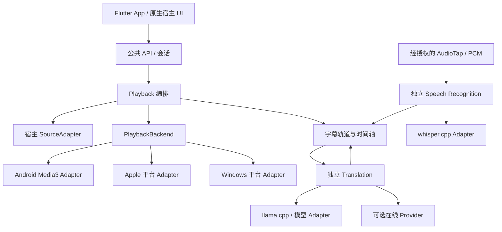

# VideoKit 播放子系统详细设计

## 2026-10-21 国际化详细设计补充（当前有效）

国际化行为遵循[《VideoKit 国际化详细设计》](INTERNATIONALIZATION_DETAILED_DESIGN_V1.0.md)，设置结构遵循[国际化数据模型](INTERNATIONALIZATION_DATA_MODEL_V1.0.md)，与[播放数据模型](PLAYBACK_DATA_MODEL_V1.0.md)保持一致。

- 界面、字幕、语音识别、翻译语言分别设置。首轮界面en/zh-Hans资源清单，不代表字幕/模型支持语言；界面SYSTEM/EXPLICIT及script回退按国际化设计，不由播放后端隐式决定。
- UI语言变化只推进localeGeneration、刷新文案/方向/格式/语义，不重建PlaybackBackend/会话，不改变bindingGeneration/timelineEpoch，不Seek、不暂停、不取消识别翻译或改变导出参数。
- 修改识别语言或翻译目标/provider，仅推进所属recognitionConfigRevision或translationConfigRevision，取消其旧任务。结果同时核媒体generation/epoch与所属configRevision；原调用及缓冲实际归还后才释放预算。真正Seek/换媒体/换音轨仍遵原媒体失效规则。
- 字幕内容、Cue时间、轨道身份与语言偏好不随UI语言改写。RTL页面不镜像视频/遮罩坐标，媒体和编辑时间轴保持LTR，字幕方向依自身内容。未知语言不默认当英文。
- Kit保持语言中立code/typedArgs；App按当前资源映射错误和轨道显示名，不以翻译后的字符串判断业务。在线翻译默认关闭，UI切换不授网络或模型下载权限。
- 验收引用I18N-01–15，尤其I18N-06四域隔离、I18N-07切换不中断真实任务、I18N-09错误映射和I18N-11方向/时间轴；与PB/ASR/TR验收分别追踪。扩展尚未准入的真实模型场景保留NOT_RUN，不以M0演示或文档更新补绿。

主里程碑及原P0不变；ASR/翻译仍单列扩展。本次仅补齐已授权文档同步，项目PAUSED_WAITING_USER，D1未过/M0未启，不恢复开发测试、设备或自动跟进。

版本：V1.0；日期：2026-10-21。用户已确认架构与复用方向；本文件是详细设计基线，不是实现、性能或发布验收通过证明。与现有技术需求文档同置 docs 根目录。

## 1. 已确定决定与适用范围

1. Flutter App UI → Flutter Binding → 独立原生 VideoKit SDK；其他原生宿主不强制依赖 Flutter。
2. Android 播放后端确定采用 Media3；Apple 使用平台播放器路线，Windows 平台后端仍待原计划验证。保留统一 PlaybackBackend 为隔离平台实现的接口，不要求每个平台同时维护多个引擎。
3. libmpv 不再列为正式选型、对照候选或计划内集成/比较任务。旧文档中相冲突的候选表述由此覆盖；历史评审及冻结证据不改。
4. 本地语音识别独立模块，优先验证 whisper.cpp；本地翻译评估 llama.cpp 配合适用模型，接口可替换。平台适配位于各能力底层，不把模型或平台对象引入公共 Core。
5. 自有开发集中在公共 API、宿主输入、会话生命周期、资源预算、字幕时间轴、任务取消、Flutter UI 与业务编排；播放解封装/解码/音画同步、ASR 和模型推理优先复用，不重新开发媒体引擎或推理算法。
6. 原 P0、只读输入、临时输出事务、独立 Kit、唯一声音及故障隔离要求不减。新识别/翻译为独立扩展范围，不静默加入当前 D1/M1 退出门，也不替代既有人脸/物体跟踪。
7. 项目仍 PAUSED_WAITING_USER；D1 未通过、M0 未启动。仅更新设计，不派开发/测试、不安装依赖、不恢复自动跟进。

## 2. 功能与依赖分层

上图翻译往返是任务输入/结果数据流，不是模块循环依赖。字幕模块仅依赖通用 Cue 数据；扩展编排订阅字幕并调用翻译，结果发布为派生轨道。Core 不依赖 ASR/Translation，纯播放发行包不打入其模型/推理库。Flutter 不持有第二套权威播放状态；UI 的拖动预览等临时状态单独命名。

## 3. 播放逻辑模块职责

| 模块 | 输入与输出 | 职责 / 不承担事项 |
| --- | --- | --- |
| SessionCoordinator | 会话命令 → 结果/快照/有序事件 | 单媒体状态机、串行命令接纳、generation/epoch、生命周期；不自写解码时钟 |
| SourceAdapter | SourceFactory/readAt → 后端数据源 | 短读、EOF、随机读能力、取消及原租约；不保存 NAS 凭据/业务路径 |
| ProbeCapability | 授权 probe 句柄 → MediaInfo/CapabilityReport | 容器编码轨道探测和实际能力分类；后缀不是播放通过证据 |
| PlaybackBackend | 统一命令/平台显示目标 → 后端事件 | Media3/平台成熟能力薄封装；不导出第三方类型 |
| TransportController | play/pause/seek/speed → 接纳/完成 | latest-wins Seek、命令排序、实际落点；不复制底层缓冲算法 |
| ClockAdapter | 后端位置/状态 → PlaybackClockSnapshot | 原媒体时间/速率/缓冲/不连续点，字幕同步；音画同步仍由后端负责 |
| VideoOutputAdapter | 宿主显示目标 → 首帧/尺寸/呈现状态 | attach/detach、旋转/fit/缩放；不把视频帧跨 Dart 消息复制 |
| AudioCoordinator | 宿主 audioEpoch/焦点 → 静音/输出事件 | 唯一声音、音量、焦点/路由适配；不在扩展里创建第二个音频 owner |
| TrackSelector | 轨道描述/偏好 → 选择及 warning | 稳定技术身份、语言/角色/编码匹配，切换后字幕/ASR 失效处理 |
| SubtitleCoordinator | 原始字幕/识别文本 → CueSnapshot | 轨道、偏移、样式、时钟查询、双语组合；不调用模型/网络 |
| SnapshotEventPublisher | 模块状态 → 版本化快照/关键事件 | 重订阅恢复、位置合并、终态查询；不持久化宿主观看数据库 |

上述是逻辑职责，不强制创建 11 个独立 Gradle 包。既有 videokit-api/core/playback/media3/image/ui/timeline/effects/tracking/export/testkit 边界保留；按可替换性/独立依赖决定物理拆包，避免巨型模块与过细空壳。

## 4. 后端与扩展接口契约

以下为语言中立的设计签名，不是已冻结的 Kotlin/C ABI；正式实现前按 PUBLIC_API_CONTRACT 评审版本与线程/所有权。

| 接口 | 主要操作 | 关键约束 |
| --- | --- | --- |
| PlaybackBackendFactory | capabilities/createBackend | 宿主注入预算；一个 backend 属于一个会话，无全局当前媒体 |
| PlaybackBackend | prepare/execute/selectTrack/attachOutput/detachOutput/clock/release | 接纳与真正完成分开；原回调/资源返回后才结束 release |
| SourceFactory | open(purpose, cancellation) | probe/playback/asr 等用途独立句柄，受同一源租约聚合约束 |
| ReadHandle | readAt/close | 沿原 64 位范围/短读/EOF=-1/零长读=0契约；正长读不得持续返回0 |
| SubtitleProvider | listTracks/openTrack/subscribeCues/close | 来源只读，外部字体/附件有界、无自动联网 |
| AudioTapProvider | capabilities/openPcmStream/close | 可选能力，PCM chunk 带原媒体PTS和epoch，不凭支持播放推断支持tap |
| SpeechRecognizer | loadModel/start/submitPcm/flush/cancel/release | 有界队列、增量revision、模型共享只读权重/独立推理状态 |
| TranslationProvider | capabilities/translate/cancel/release | 不透明任务ID、语言/上下文/模型身份，保留Cue关联，不返回播放命令 |
| ExtensionCoordinator | enable/disable/onDiscontinuity | 统一调度授权、epoch与预算；扩展失败不终止普通播放 |

平台 Surface/Texture/Context 等仅进入平台 adapter artifact。公共命令携带 sessionId、bindingGeneration、requestId，沿原结果 EXECUTED/REJECTED/SUPERSEDED/UNSUPPORTED/RELEASED；新增扩展错误码需正式 API 评审，禁止直接公开第三方异常。

## 5. 状态、线程与生命周期

会话沿 CREATED→BINDING→READY→PLAYING/PAUSED/BUFFERING→ENDED，任意非终态可进 RELEASING→RELEASED。错误按 recoverable/fatal 分层；Seek 是独立活动，不另建同权播放状态机。bindingGeneration 随媒体重绑定变化；同一媒体内 Seek、音轨更换、后端不连续由 timelineEpoch 区分，避免旧字幕/识别混入新位置。

每会话串行控制 executor；媒体读取/后端解码、字幕解析、推理分别工作线程。禁止同步 FFI/readAt 等待 UI 回调或互等执行器。原缓冲所有权持续到真实操作归还；发出取消仅代表请求，不代表底层已停止。任务逻辑终止、原调用实际返回、资源已归还分别记录；UNKNOWN 占预算并停止相应新准入，不强行归零。

重绑定顺序：关闭旧generation命令接纳→取消旧任务与读→等待原回调/资源归还→关闭租约消费者→绑定新源。旧代结果逻辑丢弃仍要完成其资源归还。Seek采用latest-wins，立即提高timelineEpoch/取消旧窗口识别翻译；后端实际seek完成发布新时钟锚点，旧任务结果不可因位置相近再次接纳。

release顺序：停止所有新任务→取消扩展与读取→等待在途回调/推理归还→detach显示目标/释放声音槽与后端→关闭各用途句柄和缓冲→聚合源消费者归零→发SourceReleased及终态。重复release复用终态，不重复物理close或宿主回调。源仍被编辑/识别任务持有时，不把单会话SourceReleased冒全租约可移动。现有D1测试工具/PID/once策略不由本文替换。

## 6. 输入、媒体呈现与资源

Android readAt→自定义Media3 DataSource，DataSpec.position映射精确偏移；读取发生在后端工作线程。顺序源不能伪装seekable，未知时长不是0时长，短读/2GiB+及源变化分别验收。Apple/Windows同语义适配，仍待M9平台任务。

后端负责解码与音画同步，ClockAdapter读取其媒体位置并保留精度/估计标记，不用系统wall clock替代媒体PTS。positionUs、bufferedPositionUs、playbackRate和discontinuity关联。UI预览位置不修改实际解码位置。方向元数据只应用一次；沿既有E/M/V/O坐标设计，观看变换不默认改导出。

视频渲染经平台显示目标或GPU纹理，Flutter仅传命令/状态/低频事件；多画面由宿主编排独立会话。音频宿主audioEpoch单调，先静音旧槽再授权新槽，拒过期epoch。平台音频焦点可委托后端实现但只有一个负责owner，不能平台与Kit双方抢焦点。

预算在模型/解码器/缓冲创建前预留，失败归还真实已返回资源。至少声明视频实例、CPU/GPU内存、PCM缓冲、ASR/翻译并发、队列、字幕大小/条数、模型磁盘/上下文及温度压力策略。数值按目标设备和原P0冻结，不从样例推断12路视频或实时推理可行。压力优先停扩展新任务/降低预取，并通知宿主，不静默破坏播放或漏掉计量。

## 7. 字幕模块详细设计

三类来源：内嵌轨道、宿主授权外挂字幕、识别生成派生轨道。字幕解析/排版优先复用后端和成熟实现，具体格式/样式能力沿原需求矩阵验证，不自写ASS等完整排版引擎。每轨明确BACKEND_RENDERED或OVERLAY_RENDERED，互斥输出，避免双重显示；文本可提取与仅图像呈现能力分别报告。双语叠加仅在可取得合法文本/受支持渲染路径时开放，图片字幕不能假装可翻译文本。

Cue区间为[startUs,endUs)，end>start，内容可text或bitmap引用；未知终点仅允许未最终化识别partial，不作为final Cue发布。字幕偏移是呈现偏移，不改原Cue时间。多个Cue重叠按原轨语义，不全部强行合并。样式是受支持能力，不把第三方完整脚本暴露到宿主。HTML/脚本/外部URL/嵌入字体按白名单与预算处理，损坏字幕不拖垮播放。

UI同时选择原文轨与其译文派生轨，保证sourceCueId/revision关联；partial更新覆盖同cue revision而非不断追加。字幕打开/关闭、字体/字号/颜色/背景/位置、编码/偏移等依原需求及平台能力，能力缺口明确记录，不能将必需格式移除。

## 8. 语音识别独立扩展 ASR

优先验证whisper.cpp+官方Whisper模型，不把其代码直接放Subtitle Engine或Core。ASR adapter调用库API而不是解析CLI终端滚动日志。音频输入走经授权AudioTap/独立只读音频解码路径，转换为模型所需PCM（Whisper路径16kHz单声道float32），chunk保留原media PTS、实际有效样本数、采样率及epoch。不得从扬声器/麦克风回录影片音频，也不因启用ASR默认申请麦克风权限。

AudioTap在硬解/受保护内容/平台限制下可能不支持；先报告能力。独立解码路径需要新源消费者及预算，不绕过DRM/宿主权限。识别使用媒体原速音频，不能把倍速后的输出PCM直接当原速输入导致错时轴。暂停是否有限预识别由用户策略及预算控制；Seek/换轨按epoch取消与flush，旧结果不可复活。

窗口、重叠、VAD、语言检测、partial/final策略适配成熟组件，按原PCM时间戳回映射。静音幻觉、重复字幕、语言切换、噪声和时间戳漂移有独立质量集。实时是待测性能，不因存在stream示例宣称手机可实时。模型缺失/加载失败/内存不足仅禁用识别并提示，不阻普通播放；模型下载/删除由宿主显式操作并核hash/权限。

## 9. 翻译独立扩展

TranslationProvider不绑定具体模型。LocalLlamaAdapter调用llama.cpp和另行选定模型；llama.cpp是推理运行时，不等于翻译模型或翻译质量承诺。评估目标语言、上下文、量化、输出吞吐、内存/功耗及模型商业再分发权，不承诺任意模型可用。

输入是文本Cue批及有限上下文，不传媒体凭据/完整路径。固定cueId/revision、源/目标语言及modelId，限制token/并发/缓存和deadline。输出只能修改译文，不修改原Cue时间或发工具/业务命令；字幕视为不可信数据，防止其指令进入模型控制prompt。检测漏段、增段、空译文及截断；失败保留原文，未知/未完成译文不冒final。

缓存键含内容hash、原cue revision、语言对、模型/量化版本、prompt策略；缓存不跨源串用隐私上下文，默认会话内存，持久化需宿主显式策略。Seek取消旧窗口任务，内容缓存可复用但结果必须重新绑定当前epoch。

在线Provider仅保留可替换接口与设计，默认关闭、默认无联网。将来启用必须用户显式选择服务并确认发送文本内容、端点/保存策略/凭据由宿主管理；不得自动将本地失败降级到在线，不上传音频/整部影片。尚未选服务，不新增权限或网络实现。

## 10. 数据模型与版本

完整字段、校验、生命周期及迁移见同目录[播放数据模型](PLAYBACK_DATA_MODEL_V1.0.md)。所有时间用int64微秒/单调计时独立标识，未知值为null+原因，不能-1混用有效量；原readAt EOF=-1语义不改变。模型对象不含平台/播放器/推理库对象。

播放事件Envelope包含schemaVersion/sessionId/bindingGeneration/timelineEpoch/requestId?/sequence/monotonicTime及payload。字幕、识别与翻译有独立track/cue/task identity与revision；不在Flutter复制权威状态。高频position合并，错误/轨道变更/取消完成/释放等关键事件顺序可查询，不静默丢弃。snapshot与edit schema各自版本化。

## 11. 技术复用及许可

Media3路线已确定，不默认升级当前锁定依赖。whisper.cpp与llama.cpp源码为MIT，官方Whisper代码及权重官方声明MIT；保留版权与许可。社区微调/量化模型、VAD、加速库、打包插件逐项审，不由MIT库许可推断任意模型/二进制许可。各项精确commit/release、源码/模型hash、依赖、构建开关、patch、NOTICE/SBOM在实施前冻结；本次不下载/安装或选择最终模型。

2026-10-21官方参考入口（分支可变，非已锁定快照）：[Media3](https://developer.android.com/media/media3/exoplayer)、[whisper.cpp MIT](https://github.com/ggml-org/whisper.cpp/blob/master/LICENSE)、[Whisper权重许可](https://github.com/openai/whisper#license)、[Whisper库API](https://github.com/ggml-org/whisper.cpp/blob/master/include/whisper.h)、[llama.cpp MIT](https://github.com/ggml-org/llama.cpp/blob/master/LICENSE)、[llama.cpp](https://github.com/ggml-org/llama.cpp)。

## 12. 子任务、验收与里程碑

主里程碑D0/D1/M0–M10编号、先后、原P0与原退出条件不变；本设计细化既有播放范围，不增加重建媒体核心阶段。按[播放子任务与验收映射](PLAYBACK_MILESTONE_MAPPING_V1.0.md)在相应主阶段实施：M0公共契约/Fake/UI演示，M1主播放能力，M3多实例，M7独立SDK，M8正式App真实接回，M9平台适配。

ASR/Translation单列EXT-ASR/EXT-TR规划，不预先指定为M1必过或M0前置；接口预留也不能冒扩展已交付。开始扩展前负责人提交子范围、所属主阶段/发布时间、模型/设备/指标及独立开发测试需求供范围确认。若用户要求其成为某版本强制退出门，必须显式更新范围/阶段门，不以“主里程碑不变”掩盖新增工作量。

每次正式派发前，将本设计的模块→子任务→验收ID→冻结候选→独立结果连成追踪；负责人按实际选择1–3主里程碑成批并说明理由，子任务仅供进度/覆盖管理，不变成每子任务一次交测。coder整批实现自测冻结，tester整包独立测试集中缺陷与回归，开发/测试要求分别保存。项目当前暂停，所有子任务PLANNED_NOT_STARTED，不自动重开D1或恢复监控。

## 13. 详细设计验收矩阵

| ID | 范围与正反场景 | 必需证据 / 当前状态 |
| --- | --- | --- |
| PB-01 | 会话命令排序、连续seek、重绑定旧代迟返 | Fake+真实backend同契约；PLANNED |
| PB-02 | 短读、EOF、未知长、顺序源、2GiB+、断连取消 | 实际readAt/租约归还及原P0样本；PLANNED |
| PB-03 | 必需容器编码/轨道、首帧、音画、倍速/缓冲 | 真机图像声音与时钟证据，非仅回执；PLANNED |
| PB-04 | attach/detach、旋转/前后台、缩放/纹理回收 | 平台目标真实生命周期，不把壳返回代全部原返；PLANNED |
| PB-05 | 原字幕矩阵、外/内嵌、偏移、重叠、样式及损坏/恶意输入 | 真实字幕/视图对照、预算，bitmap与text能力区分；PLANNED |
| PB-06 | 多实例唯一声音、过期audioEpoch、资源不足、单槽故障 | M3原1/4/9/12矩阵和释放报告；PLANNED |
| PB-07 | release/cancel与回调并发、UNKNOWN、重复release | 原owner归还/缓冲不可早复用/源聚合；PLANNED |
| PB-08 | 快照恢复、事件重订阅、schema未知版/错类型 | 样本与迁移/Fake契约；PLANNED |
| ASR-01 | PCM/PTS映射、倍速、Seek换轨、partial-final修订 | 参考音频及时间轴标注，迟代结果拒绝；扩展NOT_STARTED |
| ASR-02 | 多语言、静音/噪声、实时率/内存/热/取消 | 固定模型/设备质量报告，阈值实施前评审；扩展NOT_STARTED |
| TR-01 | cue关联/语言/模型缓存、类型/截断/漏译/prompt输入 | 双语质量集、取消和原文回退；扩展NOT_STARTED |
| TR-02 | 在线默认关闭、授权/拒绝/本地失败不自动联网 | 网络负例与隐私配置；扩展NOT_STARTED |

设计矩阵的PLANNED不覆盖或回写旧D1局部PASS/FAIL/UNKNOWN。识别WER/CER/延迟、翻译人工质量/吞吐、字幕同步容差及机型预算均需在实际派发前冻结，当前无实测数值承诺。

## 14. 未决项与冻结门

需后续明确：平台最低版本/目标机型，字幕具体格式与后端文本可取得范围，AudioTap可行路径，识别模型尺寸/语言/时间戳质量，翻译模型与语言对，跨库ggml符号/ABI冲突隔离、共享CPU/GPU竞争和原生崩溃隔离方案。whisper.cpp/llama.cpp各自锁定依赖，不因共用ggml擅自升级或混装；权重可共享不等推理context并发安全。

正式进入播放开发前，补齐数值和接口冻结记录；扩展缺模型/授权/AudioTap时准确BLOCKED，不自研解码引擎、不引入libmpv补洞、不删原格式P0。其他后端/原生高风险功能变更需单独评审。当前不以详细设计完成宣称上述验证已通过。

## 集中整理后的执行依据（2026-10-21）

[API_DATA_CONTRACT](API_DATA_CONTRACT_V1.0.md)；[NATIVE_BINDING_AND_MODULE_BOUNDARIES](NATIVE_BINDING_AND_MODULE_BOUNDARIES_V1.0.md)；[RESOURCE_AND_ISOLATION_DESIGN](RESOURCE_AND_ISOLATION_DESIGN_V1.0.md)；[METRIC_FREEZE_REGISTER](METRIC_FREEZE_REGISTER_V1.0.md)。

以上补充现有职责、接口和验收追踪，不新增主阶段或删除原P0。历史设计原文已归档，不再作为并行指令；当前项目暂停，不能以本文触发开发测试。
