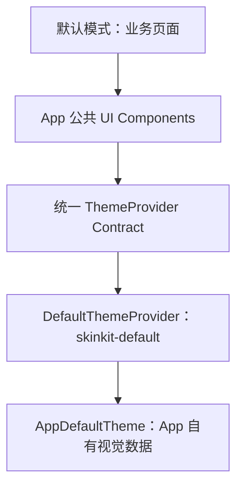
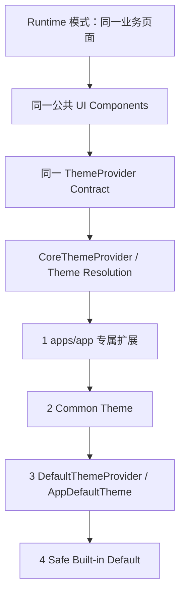

# SkinKit Ready 开发规范 V1.0

> **Git 提醒（置顶，必须执行）：** 开始接入前确认仓库、当前分支及工作区状态，保留既有修改；在可追踪的分支完成接入，提交前检查差异、资源与依赖锁定。不得提交密钥、支付凭据、账号令牌或无权分发的主题资源。不得为接入 SkinKit 擅自重置、覆盖或删除其他人的工作。每次 Contract / 默认主题变更须记录兼容影响和验证结果。

文档版本：V1.0  
更新日期：2026-10-07  
状态：宿主 App 接入规范，按当前开发版实现修订  
关联文档：《SkinKit 用户需求文档 V1.0》《SkinKit 系统架构设计 V1.0》

## 0. 本次修订与交付边界

本版保留 2026-10-05 原规范的永久默认主题、类型安全、四级回退、模块隔离与宿主责任要求，并按 2026-10-07 的实际实现修正接口和阶段描述。运行时基线为 `2ee5c29d`；集成交付包标识为 `0.3.0-integration-r1`，包标识不替换各模块自己的 Maven 版本。

当前可用：Contract / Default、Core 本地包校验与生命周期、五套内置风格、可选 Appearance、严格本地照片导入与个人主题编辑。演示版为 `dev.skinkit.testlab`，versionCode 10，versionName `0.3.0-demo-sdk-r1`，显示名称“SkinKit 演示”。开发者资源入口用于导出随包的两份规范和二进制 SDK；不会导出用户照片、草稿或当前个人主题。

交付为 Android/JVM 开发版集成 SDK。`dev.*` 坐标、局部实机测试、通过 R8 编译均不表示生产就绪、商店认证、跨平台支持或无法反编译。Store / Commerce / Community 的接口和本地测试路径不能表述为已配置线上服务。微信专有 Android 适配器及其 SDK 不在本次二进制包中。

“必须 / 应当”描述宿主应完成的工作；“已验证”只采用第 17 节限定的证据。本文未把全部需求和测试矩阵标记为通过。

## 1. 目的与强制语义

本文回答宿主 App 现在如何准备并接入 SkinKit。MUST / 必须表示发布门槛，SHOULD / 建议表示可说明理由后调整的工程建议。本文接口名称以当前 SDK 的正式声明为准。Contract / Default 已有可用二进制；禁止各 App 复制并独立演化另一套契约。规范中的发布要求仍须由每个宿主实际验证，不能把要求本身当成通过记录。

当前 App 依赖 skinkit-contract 0.0.1 + skinkit-default 0.0.1 即可开发、测试、发布。加载本地 skinpack 时增加 skinkit-core；Core 是换肤 Runtime 的必选模块，UI / Store / Animation / Creator / Commerce / Community 均按需接入。contract/default 在 Core 完成后永久保留。

## 2. 默认模式与可选 Runtime 调用链





启用 Core 时在依赖注入入口增加 Runtime Provider 和解析层，不重写业务页面。图中优先级链表示当前候选缺失、非法、不兼容或不受支持时才进入下一候选。

SkinKit 管理外观，App 管理页面结构、导航、业务交互、触控区域、可访问性和业务状态。宿主 Theme Center 可调用统一服务；My Themes / Editor 可使用已交付的 Personal Android 页面。App 公共组件即使不接 UI 模块也必须能渲染默认外观。

## 3. 宿主接入步骤

1. 采用已实现的 contract/default 0.0.1，遵守唯一 ThemeProvider API、Token、值类型、Fallback、Extension / Capability 协议。
2. App 锁定正式依赖版本；声明稳定 appId、所用 Token、组件状态和扩展能力。
3. 实现完整 AppDefaultTheme（例如 PlayerDefaultTheme / LVBDefaultTheme），包含全部业务所需默认视觉和本地资源。
4. 使用 skinkit-default 的通用 DefaultThemeProvider 执行器；具体视觉数据归 App，不能写入 Contract。
5. 公共 UI Components 仅通过统一 Contract 获取可主题化外观；业务页面调用公共组件。
6. 建立默认完整性检查、无网络启动和回退测试。
7. 先完成宿主自身的默认模式验收，再按需接 Core 和可选模块。演示 App、Pocket List 和独立二进制 sample-host 提供接入参考；它们的测试不会自动替其他 App 完成验收。

## 4. 强制 ThemeProvider API Contract

### 4.1 类型安全接口

```kotlin
interface ThemeProvider {
    val snapshot: ThemeSnapshotInfo
    fun getColor(token: ColorToken): ColorValue
    fun getTypography(token: TypographyToken): TypographyValue
    fun getDimension(token: DimensionToken): DimensionValue
    fun getDrawable(token: DrawableToken): DrawableValue
    fun getIcon(token: IconToken): IconValue
    fun getAnimation(token: AnimationToken): AnimationValue
    fun <S : ComponentStyle> getComponentStyle(token: ComponentToken<S>): S
}

data class ThemeSnapshotInfo(
    val generation: Long,
    val themeId: String?,
    val themeVersion: String?,
    val contractVersion: String
)
```

必须使用区分类型的 Token，不能使用 get(String): Any，也不能把 ColorToken 传入 getDimension。ComponentToken<S> 必须绑定 style schema 与其类型安全的默认构造器；按钮 Token 返回 ButtonStyle，不能运行时强制转换成 CardStyle。对外同步 getter 返回已解析的非空值，不进行网络请求、磁盘读取或重资源解码，不向业务组件抛出主题缺失异常。

界面通过 PinnedThemeSource.pin() 获取同一不可变 generation 的 ThemeReadView，避免一次渲染混用两套主题。资源工作取得自己的 lease 后才可提前释放 read view；释放后禁止继续读取。observeSnapshot(SnapshotObserver) 立即回放当前状态，返回的 Subscription 须随页面释放，回调应按平台要求转交 UI 线程。当前提供原生 Android Views 接入；未交付通用 Compose、Swift 或桌面 Adapter。snapshot 不含用户支付信息。

### 4.2 强制值模型

| 类型 | 语义与限制 |
|---|---|
| ColorValue | 明确色彩空间与 RGBA，支持声明的状态变体；平台转换由 Adapter 负责 |
| TypographyValue | 字体引用/系统字体、字号、字重、行高；遵守字体缩放与字体缺失回退 |
| DimensionValue | 带单位和用途（dp/sp 或平台逻辑单位）；范围校验，不能直接作为业务布局指令 |
| DrawableValue | 安全资源句柄与缩放策略；加载中有本地占位/默认背景 |
| IconValue | 安全图标引用、尺寸与 tint 语义；业务可访问性标签由 App 提供 |
| AnimationValue | 静态资源或声明式动画描述；允许显式 Disabled / Static，不能返回空指针 |
| ComponentStyle | 有类型 schema 的视觉字段及状态样式；不包含导航、点击回调或业务布局树 |

默认 ThemeProvider 可在没有 Animation 模块时返回 Disabled 或静态后备。资源 getter 返回句柄，解码由异步资源服务完成；句柄解析失败必须触发同 Token 的下一层候选。

### 4.3 AppDefaultTheme 与 DefaultThemeProvider

```kotlin
// appDefaults 与 registry 由宿主构建；二者必须使用同一组原始 Token 实例。
val provider = DefaultThemeProvider(
    defaultTheme = appDefaults,
    tokenRegistry = registry,
    configuration = VisualConfiguration(colorMode = ColorMode.LIGHT)
)
provider.completenessReport.requireComplete()
provider.pin().use { view ->
    val background = view.getColor(backgroundToken)
    // 公共组件在此 generation 内读取其所需的其他值。
}
```

AppDefaultTheme 必须覆盖 Token Registry 中所有必需 Token 及组件必要状态/字段，资源随 App 打包、本地可访问；包含默认深浅色配置与 App 实际支持的视觉状态。SafeDefaults 由 skinkit-default 内部使用，无须在 DefaultThemeProvider 构造器中传入 safeDefaults 参数，也不依赖 Core。AppDefaultTheme 是通过 AppDefaultTheme.builder(appId, version) 构造的不可变数据对象，不能按旧伪代码实现成 interface。自定义 ComponentStyle 必须在注册时提供有类型的安全构造器，避免通用安全值无法构造 App 专属样式。

任何使用安全默认的必需 Token 都须记录诊断，且在默认完整性测试中判为失败；不得把第四级兜底当成缺失默认数据的常规做法。

## 5. Token namespace 与组件规则

| 命名空间 | 示例 | 所有权 |
|---|---|---|
| color.* | color.primary、color.background、color.text.primary | Common 标准 |
| typography.* | typography.title、typography.body | Common 标准 |
| dimension.* | dimension.corner.card、dimension.spacing.control | Common 标准 |
| drawable.* / icon.* / animation.* | drawable.background、icon.close、animation.character.idle | Common 标准 |
| component.* | component.button.primary、component.card.default、component.progress.default | Common schema |
| apps.<appId>.* | apps.player.component.progressbar、apps.lvb.component.mediacard | 相应 App Extension |

Token 使用稳定、小写分段标识，appId 不以显示名称或可变化的包标题代替。common 和 apps/<appId> 是包存储路径，Token namespace 是逻辑键；二者不可混用。

历史示例 button.primary / card.default / player.progressBar / browser.mediaCard 在规范中分别对应 component.button.primary / component.card.default / apps.player.component.progressbar / apps.lvb.component.mediacard。当前 Registry 严格要求全小写分段，不提供自动别名系统；progressBar / mediaCard 等旧设计示例不是可注册键。若已有旧键数据，必须另行评审显式迁移，不允许各 App 暗中映射或声称 SDK 会自动转换。

Common Token 不得被 App 改成另一种类型；新增通用 Token 需 Contract 治理。扩展 Token 只能位于本 App namespace。尺寸 Token 可描述内边距、圆角等视觉属性，不能让皮肤重排业务页面或缩小必要触控目标。

## 6. 强制 Fallback 与覆盖语义

每个 Token / 样式字段按以下候选顺序解析：

1. 当前已验证主题的 apps/<当前 appId> 专属 Skin Extension。
2. 当前主题 Common；专属 Token 只有在 Extension 声明兼容映射时才能使用 Common。
3. AppDefaultTheme，经 DefaultThemeProvider 解析。
4. SkinKit Safe Built-in Default；由 default 中的安全值与注册的有类型安全构造器提供。

候选缺失、类型错误、版本不符、Capability 不支持、资源缺失/损坏或安全检查失败，跳到下一候选。ComponentStyle 按同 schema 的字段合并，不能用不完整扩展替换整个默认对象；必要字段最终必须完整。

未登录、离线或 Store 故障不意味着已验证本地免费主题必须停用。SkinKit 加载失败则直接使用 DefaultThemeProvider。付费权益不可确认时按 Commerce 的离线政策决定是否允许覆盖；无论结果如何，App 默认外观和业务必须可用。

异常降级不得造成崩溃、空白、透明不可见的必要控件或界面卡住。切换预先验证并原子发布；失败保留上一可用快照或回默认。恢复默认是本地操作。

## 7. Extension / Capability 协议

### 7.1 ExtensionDescriptor

每个 App 必须声明 appId、extensionId、extensionVersion、Contract 兼容范围、Token / Component schema、Common 映射、资源限制、默认值及安全构造器、可选编辑器元数据。Extension 只提供视觉适配与宿主已实现的扩展点；禁止远程包注入业务代码、反射入口或页面布局树。

例如播放器 progressBar 仅可把相容的轨道颜色、填充颜色、圆角映射到通用 progress 样式；播放器拖动行为、时间刻度和播放控制由 App 实现。

### 7.2 CapabilityDescriptor

能力声明必须区分宿主能力、已安装模块能力、主题需求，并包含 capabilityId、版本、supported 状态和限制。示例：static.drawable、icon.vector、animation.character、overlay.character、extension.player.progressBar。Registry 判断版本与限制后才允许生效，不可仅靠字符串存在判定兼容。

包内 required capability 缺失时，拒绝激活该不兼容包并保留当前可用主题；optional capability 缺失时，只禁用相应资源并回退。不支持动画的 App 不加载 Animation 模块也必须正常运行。

## 8. Overlay / Decoration / Character Layer 接入

App 定义允许的锚点、区域、安全边距、层级、裁剪、输入策略和开关。主题只能选用这些视觉扩展点。装饰默认不拦截触摸，不进入读屏焦点；有交互的角色须由 App 显式授权并提供可访问性语义。尊重减少动画、后台暂停、电量/性能限制和隐藏设置。

顶部大型卡通角色是通用 Character Layer 的一个实例，不写成单一 App 的特殊页面。角色资源失败使用静态后备或隐藏装饰，必要业务操作不受影响。

## 9. 可选模块与宿主入口

App 仅依赖实际使用模块；业务组件依赖 Contract，不直接调用 Store / PaymentProvider。模块通过 Registry 和服务接口提供能力，缺失时入口不显示或明确提示不可用，不以反射加载未安装模块。

当前“我的主题 / 创建主题”由可选 skinkit-personal-android 提供，底层服务位于 skinkit-personal；不存在已交付的通用 skinkit-ui 模块。宿主自有 Theme Center 必须按可用服务显示功能。本地主题列表可由 Core 提供，不强制 Store / Commerce。付费功能使用统一 Entitlement，不读客户端 bool 作为真实购买权。商品 scope 使用稳定 appId / app family 标识；账号与支付平台身份由共享服务关联。

## 10. 强制测试矩阵

| 场景 | 必须验证 |
|---|---|
| 仅 Contract + Default | 所有业务页面、组件和必要状态完整；无 Core 可发布 |
| 首次启动 / 无主题 / 未登录 | 默认外观完整；不得等待账号或网络 |
| 离线 / 网络超时 / Store 不可用 | 默认业务正常，已验证本地主题按政策可用 |
| 只含 Common 的包 | 支持部分生效，专属组件回默认 |
| Extension 与 Common 同时命中 | 扩展优先；未覆盖字段继续按四级解析 |
| 扩展 Token 无 Common 映射 | 直接回 App 默认，不能猜测适配 |
| 缺失 / 错类型 / 越界值 / 资源损坏 | 逐项回退且可诊断，不崩溃/空白 |
| 不兼容 schema / 必需 capability 缺失 | 激活失败，当前可用快照或默认不受损 |
| 动画模块缺失 / 失败 / 减少动画 | 静态或 Disabled；必要功能可用 |
| UI / Creator / Commerce / Community 故障 | 故障局限于模块，不拖垮业务页面 |
| 切换 / 连续切换 / 后台 / 重启 | 快照一致、订阅释放、上一可用状态可恢复 |
| 下载中断 / 更新失败 / 缓存清理 | 不激活半包，不删除 App 默认资源 |
| 字体缩放 / 深浅色 / 读屏 / 触控 | 可读、可操作，业务可访问性保持 |
| 权益到期 / 恢复 / 撤销 / scope 不匹配 | 覆盖按政策处理，默认业务无条件可用 |
| Android 与后续平台 Adapter | 同契约输入产生同语义结果，平台差异明确 |

默认模式执行默认、类型、Registry 和接口兼容测试；其余矩阵随所接入模块执行，不能把未执行的测试标记为通过。需提供一个部分覆盖包、一个损坏包及一个不兼容包用于 Core 验证。性能预算在 V0.1 基线测试后冻结，并按设备等级维护。

## 11. Code Review Checklist

- [ ] Git 状态、变更范围、资源许可与依赖版本已检查。
- [ ] 使用唯一正式 Contract，未自建不兼容 ThemeProvider。
- [ ] 七类 getter 类型安全；ComponentStyle 无不安全类型转换。
- [ ] 必需 Token / 状态 / 资源均有完整本地 AppDefaultTheme。
- [ ] 公共视觉从公共组件与 Token 获取；默认设计常量仅在默认主题数据/安全适配中定义。
- [ ] 业务页未新增硬编码公共颜色、字号、背景、圆角或主题资源路径。
- [ ] appId、namespace、schema、扩展映射与 capability 已注册和验证。
- [ ] 四级回退、资源失效与字段合并符合规范。
- [ ] 同一渲染使用同一快照，无同步网络/磁盘读取。
- [ ] SkinKit 未控制业务布局/导航/业务权限。
- [ ] 可选模块缺失与故障隔离已验证。
- [ ] 装饰层、字体缩放、减少动画与可访问性已检查。
- [ ] 未计划未来删除 AppDefaultTheme 或 contract/default。
- [ ] 测试结果、兼容影响、迁移说明与诊断记录可审阅。

## 12. Definition of Done

### 默认模式 Ready

唯一 contract/default 0.0.1 二进制已交付并锁定；API、类型模型、Token、Fallback、Extension / Capability 已冻结；App 全部业务 UI 通过公共组件使用 Contract；完整 AppDefaultTheme 与本地安全后备可用；宿主自己的关键页面完成验证并记录责任人；Sample / Demo 的通过不代替宿主验收。未选用的 Core、商店和动画不影响默认模式独立发布。

### Core 接入完成

只增加 CoreThemeProvider / Resolution 注入，不重写业务页面；部分覆盖、四级回退、包校验、原子切换、离线与故障隔离通过；平台预算和诊断可验证；恢复默认可本地执行；contract/default/AppDefaultTheme 永久保留。

### 可选模块接入完成

只接所需模块，服务边界和能力声明清晰；相关矩阵通过；失效时可退回原有可用状态；平台自身页面复用已提供的 Personal 页面或统一服务，而不是复制另一套平台逻辑。商务接入额外通过购买验证、恢复、scope、跨 App 身份和撤销测试。

## 13. 明确禁止

禁止各 App 自建不兼容 ThemeProvider；禁止业务页硬编码公共视觉；禁止等待 SkinKit 完成才开发 UI；禁止未来删除 AppDefaultTheme；禁止让 SkinKit 控制业务布局；禁止默认主题依赖远程资源、商店或登录；禁止未校验的主题进入当前快照；禁止为方便调用把 Contract 变成网络、账号或支付 SDK。

## 14. 当前二进制 SDK 与依赖选择

全部坐标的 group 为 `dev.skinkit`。优先使用随包 Maven 仓库和 POM 解析传递依赖，不把一堆 AAR 手动复制到 libs 后忽略依赖。

| 模块 | 当前版本 | 类型与用途 |
|---|---|---|
| skinkit-contract / skinkit-default | 0.0.1 | JAR；永久基础契约与本地默认执行器 |
| skinkit-core | 0.1.0-dev.12 | JAR；验证、回退、安装、预览、应用、恢复与租约 |
| skinkit-appearance | 0.1.0-dev.3 | JAR；四类外观 Token、几何、配色与布局策略 |
| skinkit-appearance-android | 0.1.0-dev.3 | AAR；PNG 解码与原生 Drawable |
| skinkit-personal | 0.1.0-dev.2 | JAR；个人主题模型、存储与编译应用服务 |
| skinkit-personal-android | 0.1.0-dev.2 | AAR；可复用本地编辑页面与 Activity 接线 |
| skinkit-photo-android | 0.1.0-dev.1 | AAR；本地所选照片规范化 |
| skinkit-creator / skinkit-creator-core | 0.1.0-dev.1 | JAR；类型化草稿及 Core 桥接 |
| skinkit-animation-policy / skinkit-animation-preflight | 0.1.0-dev.1 | JAR；受限动画策略与预检 |
| skinkit-animation-android | 0.1.0-dev.11 | AAR；可选 Android 动画播放器 |
| skinkit-store / skinkit-store-core | 0.1.0-dev.1 | JAR；可选 Store 接口和桥接 |
| skinkit-commerce / skinkit-community | 0.1.0-dev.1 | JAR；可选服务接口，不含已配置服务器 |

最小默认模式只需 `implementation("dev.skinkit:skinkit-default:0.0.1")`，Contract 由 POM 传递。需要本地 skinpack 时加入 Core；需要四类图片表面时加入 Appearance Android；需要现成个人主题页面时加入 Personal Android。依赖范围与 Manifest 权限必须在最终宿主核对。

本次 17 个模块为 13 个 JAR 和 4 个 release AAR。SDK 包不交付其实现源码或 sources JAR；`sample-host/` 仅包含宿主接线示例源码。闭源分发并不防止字节码反编译，不得把密钥、账号令牌或支付信任根依赖隐藏在客户端实现中。

Android 模块 minSdk 26、compileSdk 36；Java 17 字节码。随包示例使用 Gradle 9.6.0、AGP 9.4.0、JDK 21 运行构建。Android SDK/构建工具不是 SDK ZIP 的一部分；离线构建还需要本机已有对应工具与缓存。生产项目须评估自身工具链兼容性，不能只改 minSdk 就声称低版本受支持。

## 15. 当前 Core 与 Appearance 接入路径

### 15.1 构建与保存一套可信宿主声明

1. 用 `TokenRegistry.builder(appId)` 注册所需 Token。启用 Appearance 时在 freeze 前调用 `AppearanceTokens(builder)`；它注册 `drawable.appearance.button/window/form/card`。
2. 保存原始 Token 实例并 `build()` 冻结 Registry。同名新实例不等于同一 Token；不能在每页重建 Registry。
3. 使用 `AppDefaultTheme.builder` 为 LIGHT / DARK 全部必需 Token 和状态填值。资源默认需声明 `LocalResourceCatalog`；无图模式使用明确的 `DrawableValue.Solid`。
4. 用 `DefaultThemeProvider(...).completenessReport.requireComplete()` 检查完整性；默认不足时即使安全兜底可渲染，也不算宿主接入合格。
5. 需要 Core 时构造 `CoreThemeProvider(appDefaults, registry, configuration, extensionDescriptor)`。不要创建旧文档中的 `SkinKitThemeProvider`，该名称不是当前 SDK 类。

### 15.2 串行存储与本地包

在 worker 上构造 `SkinPackLoader(registry, PackageLimits(), capabilities, extensionDescriptor)`、`ThemeStore` 和 `CoreThemeSession(provider, store)`。Android 只规范化可信的 `filesDir.canonicalFile` 父目录，再创建固定私有子目录；不要先 canonicalize 不可信子路径而绕过符号链接检查。

启动调用 `session.start()`，等恢复完成后允许变更。安装使用 `session.install({ inputStream }, PackageOrigin.EXPLICIT_LOCAL_DRAFT)`；安装不会隐式应用。`preview(archiveDigest)` 返回应关闭的隔离预览，`activate(archiveDigest)` 显式应用，`restoreDefault()` 本地恢复默认。所有异步结果需检查状态，并将 UI 更新转交主线程。关闭预览不等于回滚已提交应用；取消 future 也不等于撤销存储提交。

本地 SHA-256 是完整性和版本身份标识，不能充当发行者签名或商城购买证明。当前静态包 schema 为 `0.1.0`，宠物可选受限动画使用 `0.2.0-animation-dev.1`；只承诺已实现的格式与白名单，不接收执行脚本、任意资源 URL 或主题控制的布局树。

### 15.3 一次渲染与异步图片

从 `provider.pin()` 取得 `CoreThemeReadView`，在该 generation 内读取所有值。`AppearanceImageLoader.load(view, ref)` 必须在 read view 尚未释放时发起；加载器先取得自己的资源租约，随后宿主才可释放 read view。回调需要同时核对页面 render ticket 和当前 generation。旧回调不得覆盖新页面，也不能读取已释放的 view。

`ThemeSurfaceDrawable(value, role, baseColor, ...)` 负责按比例绘制；宿主负责文字保护矩形、原生状态、inset、裁剪与触控区域。照片应用时同时设置 `setCropFocus(x, y)` 和 `setImagePresentation(scale, repeatFullImage)`。只对实际数据解码失败报告带 generation 的 `reportResourceFailure`；取消、页面过时或暂时内存压力不应污染主题候选。

加载失败保持实色后备。纯色值无需图片解码，也不保留不存在的装饰空白。配色通过 `AccentPalette.from` 计算；其 4.5:1 保证仅针对传入的实色前景/背景，不保证任意照片背后的文字对比度。

## 16. 可选本地个人主题与照片

### 16.1 模块职责与真实 API

宿主从同一 Registry / Extension 建立 `CreatorSchema`，再建立 `PersonalRoleDirectory`。当前示例为 button、window、form、card 四角色；目录可扩展至 64 个独立角色/Token，不要求复制 SDK 实现。

在 worker 上创建 `PersonalThemeStore(privatePath, schema, directory)`，注入 `PersonalThemeService(store, session, schema, directory)`。自建页面可直接使用该服务；现成页面为 `PersonalThemePage`，Activity 接线为 `PersonalThemeLauncher(activity, store, session, requestCode, onSaved, onClosed)`。三者均借用宿主 Store / Core Session，不取得其最终关闭权。

`newWorkingCopy` / `edit` 创建不可变工作副本，`preview` 不保存、不安装、不应用；`saveDraft` 只保存草稿；`saveAndApply` 校验、保存新修订、安装验证副本并显式应用。保存后应用失败时 `PersonalApplyException.saved` 记录已保存版本，应从该版本重试，不能显示“什么都没保存”。

### 16.2 全局图片和每角色三态

- `INHERIT_GLOBAL`：跟随全局图片；全局为空时显示实色。
- `OWN_IMAGE`：使用该角色自己的图片；更换全局图片不影响它。
- `NO_IMAGE`：明确编译为 Solid，只用颜色；不是清除 override 后露出旧皮肤图片。

配色独立于图片；改变配色不会染色、改写或重新编码照片。继承同一全局图片的角色共享该图片已有的 focus；独立图片持有自己的 focus。每角色 mode/scale 独立，即使共用图片，按钮缩放也不能改变卡片。

### 16.3 位置与缩放

`ImageFocus(x, y)` 使用方向校正后图片的 0..1 坐标。原布局为 FILL，FORM 默认 FIT；FILL 的位置有边缘约束，不能露白。FIT 默认保持适应行为。

`ImagePresentation(ORIGINAL, scale)` 范围 1.0..2.0，对应原布局 100%–200%；放大后可裁切，不保证看见整张图。`ImagePresentation(REPEAT, scale)` 范围 0.25..1.0，对应“完整平铺（可缩小）”25%–100%，编译为现有 `ScaleMode.TILE`。切换模式回到该模式 100%；“恢复默认布局 · 100%”恢复原布局，不更换图片、位置、配色或其他角色设置。

完整平铺保留源图四边及透明留白。按钮使用单行重复，100% 先适配按钮高度，超宽图同时适配宽度；缩小后横向副本增多，顶部/底部完整，最左/右边界副本允许部分裁切。其他角色在其装饰区域内双轴重复，图案高度基准上限 80dp。所有变换等比例；每次绘制上限 4096 tile，超预算保留实色后备。

### 16.4 本地导入和持久化

仅使用系统文件选择器读取用户选中的 JPEG / PNG / WebP，限制本地内容；不扫描图库、不上传、不请求宽泛存储权限、不保存源 URI。输入上限 16 MiB、单边 8192、总像素 16,777,216；接受范围是受限的静态格式子集，并非所有同扩展名文件。HEIC/HEIF、GIF、AVIF、动画 PNG/WebP、渐进/多扫描或 CMYK JPEG、不支持的 PNG 模式和 ICC/广色域/XMP 等明确拒绝。

规范化输出为去元数据 sRGB 静态 RGB/RGBA PNG，保留 alpha，单边不超过 1024、单图不超过 4 MiB。包仍受 8 MiB 压缩 / 16 MiB 展开预算限制。导入有单 worker、两项队列和期限；不承诺能强制终止不配合的 Android 原生 codec/provider，也不把原生临时分配宣称为硬内存上限。

个人 manifest v2 可读取 v1，以 ORIGINAL / 100% 默认值迁移；未知版本、损坏引用或非法 scale 拒绝写入并保留数据。写入 v2 后旧 code8 不支持反向读取。正常升级不清数据；Git 源码回退标签不能把用户数据降级，禁止把降级 APK 或清空数据当成常规修复。

保存/应用后的 focus、配色、mode/scale 按确切 themeId/version 固化。后续未应用草稿不改变当前外观；删除草稿不立即删除正在用的 Core 副本。清理只处理精确匹配、非当前/恢复/租约占用的版本；Core 16 包上限不能通过删除其他主题绕过。

### 16.5 生命周期

旋转前捕获 `launcher.captureState()`，通过 Activity 的非配置实例保留；旧页面 `closeAsync()` 完成、替代 Store / Session 可用后 `open(configuration, restoredState)`。保留的是不可变临时编辑数据，不能放进 Bundle、写入磁盘或携带 Activity/Bitmap/URI。进程死亡会丢失未保存编辑；旋转保留不等于自动保存。Cancel / Back 仍丢弃未保存副本。

正在提交时等待 drain，恢复当前列表而非重试旧工作副本。提交/清理期间宿主须独占 Core Session 的变更权，并先等已有变更队列完成；只读 pin、库存查询与隔离预览可以继续。退出后先等页面/加载器关闭，再在 worker 关闭借用存储和 Session，不能阻塞主线程。

## 17. 当前验证证据与未完成范围

运行时基线的 focused JVM 报告为 164 项、零失败/错误/跳过；覆盖几何、迁移、存储、角色隔离与生命周期模型。Contract 102 / Default 15 类清单与基线一致；旧 Kotlin Personal / Appearance consumer 和旧 Java Core consumer 的未改字节码运行通过。此为记录在案的 RC5 基线结果，不声称本文编辑时重跑全部历史测试。

本次独立二进制 sample-host 在无 SDK 项目源码依赖条件下，基础和可选动画依赖变体分别通过 3 项 JVM 测试及 R8/resource shrink release 构建；release 为未签名测试产物。通过编译/混淆仅证明该示例与当前依赖图可构建，不等于全部宿主混淆规则、设备播放或生产运行已认证。

已转述的 Android 12 / API31 code9 局部回归：按钮完整平铺 100/50/25%、仅 25% 的上下位置端点、未保存旋转与 Cancel、按钮/卡片缩放独立、恢复默认布局及测试中的保存应用重启。原始设备截图和报告不在云端证据集中，不能表述为本次独立复核。

仍未建立：100/50% 位置端点、code9 窗口/表单复测、卡片 25% 的单独重启、大字体/TalkBack、完整原生格式与八方向像素矩阵、低内存/超时设备行为、第二宿主 UI、实体机与广泛 Android 版本覆盖。code10 的集成包装、导出入口和新 APK 需要自己的设备验收；不得直接继承 code9 全部设备通过结论。

## 18. 随包 sample-host 与最终接入检查

独立 `sample-host/` 是 `dev.skinkit.binaryhost`，只读取相邻 `maven/` 二进制；与演示 App 和 Pocket List 是不同身份。示例源码仅包含宿主 Activity、Token/default、存储、渲染、Personal 接线等，不包含 SDK 实现。

阅读顺序：ShowcaseTheme → ShowcaseStorage / ShowcaseRuntime → ShowcaseSurfaces → ShowcasePersonal → AppearanceShowcaseActivity → BinaryApiTest。用 `-PskinKitRepo=/absolute/path/to/maven` 可指定仓库。`:app:testDebugUnitTest :app:assembleDebug :app:assembleRelease` 验证基础版本；`-PwithAnimation=true` 检查可选动画依赖闭包，示例屏幕仍声明静态能力，不据此承诺播放验收。

接入交付前必须另行记录：最终依赖锁与许可证、签名/权限、宿主 AppDefault 完整性、generation 与 lease 释放、保存失败处理、升级保留数据、默认恢复、无可选模块构建、R8 与真机 UI。任何不通过项保留为未完成，不以 Demo 能启动替代全部 Ready 条件。

## 19. 一次付费下载、商用授权与演示边界

正式 App 采用应用商店一次付费购买并下载的方式，不提供应用内购买，不设置额外的 SDK 或接口文档导出购买。安装后提供演示及导出功能。合法购买后允许将 SDK 用于商业项目，不再缴纳后续使用费。

该授权包含以后发布的 SkinKit 集成 App、SkinKit SDK 和接口说明文档的全部更新，无须另付更新费用。价格、目标商店和正式发行条款仍待确定；本文不额外承诺无关 App、定制开发或支持 SLA，也不创设未讨论的转售/转授权安排。第三方依赖和素材的许可证义务继续适用。

当前 code10 是可演示、可导出的开发预览，尚未成为付费商店构建；本次没有市场提交、生产签名或新增支付 SDK/账号/后端。应用介绍页应充分说明实际能力、限制和接入方式，并使用真实的界面截图展示效果；这不代表已创建商店页面或已有本次实机截图。

当前 SDK ZIP 与文档明文嵌入 APK，可直接提取，购买用户也可正常导出。商店付费下载控制初次获取，不保证阻止 APK/导出文件被复制。闭源只表示不提供 SDK 实现源码，不能保证无法反编译。本演示不是 DRM 或应用内购买解锁系统，也不会导出密钥、用户照片或个人主题。
