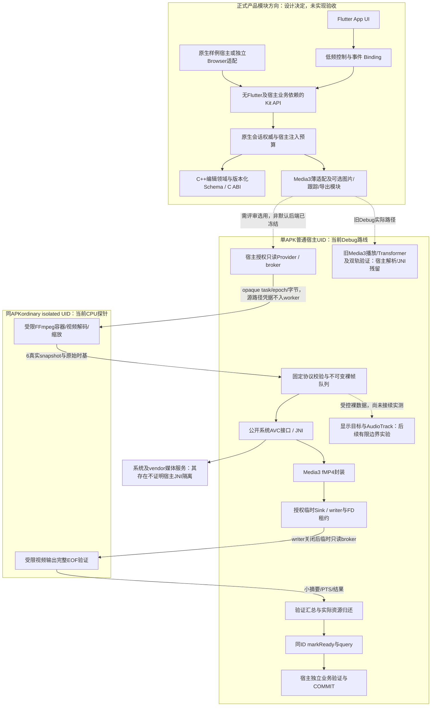

# D1 R1 架构准入评审 V1.0

日期：2026-10-16。结论：**D1继续等待关键证据与负责人裁定，M0未启动。** 本批仅阅读既有源码/需求/报告和新增三份文档；不修改C14、不编译、不操作ADB/设备、不创建新候选。本文提出决定候选，不批准变更验收、默认后端或许可。

## 1. 可直接用于评审的结论

1. 维持原始全部P0、Flutter App＋独立原生Kit/AAR/C ABI、Media3薄适配、Android先行。内部Maven group `com.videokit`、SDK namespace `com.videokit.<module>`、App `com.videokit.app`已定；正式artifact/version兼容尚待验证，不再重问命名或UI路线。
2. C13系统signal0严格FAIL保留；它与该任务实际死亡、Source/slot归还、另一任务/宿主存活分别判定。原始需求要求故障后果安全，并未逐字要求App每次读到原始11或tombstone。现追加门槛仍有效；建议负责人独立裁定其D1地位，无新采集条件时停止同条件重跑。即使以后批准改变追加门槛，也不能据此宣布产品故障隔离P0通过。
3. 真实接续是当前直接影响路线可行性的缺证：C13两正例configure失败，六帧/PTS/内容/EOF未进入；C14只完成本机开发与核验，设备尚未运行。下一次设备可用时先验冻结C14，不能因为本机871条断言而跳过这一关，也不为等待设备制造新候选。
4. 公共安全不变量可作为下一次契约评审基线，整体API尚不能宣布冻结：未知长度/非seekable、真实provider取消/迟到、聚合SourceReleased、通用Sink能力/可读验证租约/query、跨宿主Manifest/签名、Flutter/平台控制权仍有具体差距。逐项见[需求矩阵§4](D:/CodexProjects/VideoKit/docs/coder/D1_R1_REQUIREMENT_GATE_MATRIX_V1.0.md)。
5. D1应证明关键路线可行并处置会改变基础接口的不可行问题；M1–M8完成真实产品矩阵。不能把M5全部跟踪质量、全部图片/UI/热矩阵前置到D1，也不能把合法模型路线、源/Sink所有权或完整危险链未决简单推到后续后宣告D1通过。

来源与逐项追踪统一在[需求与门禁矩阵](D:/CodexProjects/VideoKit/docs/coder/D1_R1_REQUIREMENT_GATE_MATRIX_V1.0.md)；以下引用U/D/S/A/E/T/L/M/G/B/R12/R13/C14/W14均对应其精确来源索引。

## 2. 当前证据账本及冲突处理

| 对象 | 有效结论 | 禁止外推/下一步 |
|---|---|---|
| C12正式报告R12 | 平板52 PASS，手机52环境阻断；特定CPU帧、注册/解绑/代次/真实释放及host/legacy回归 | 两OS11且无trace不覆盖C13的系统0，也不是全格式/全产品完成 |
| C13正式报告R13 | 平板52 PASS/3 FAIL/14 BLOCKED；两新管线configure FAIL；self系统0严格FAIL，实际原代资源归还另有证据；独立双槽OS11 PASS | 错误数字不唯一指颜色/profile/权限；零源帧不能指控解码器已失败。14反例保留前置阻断，不写成已执行 |
| C14冻结候选 | 2026-10-16T12:33:42.094772+08；freeze SHA `880b38f3896df2f6bed2657d54c7fb8a954d3d05d8c730faf1b11278726e7155`；342源/139证据/5产物；871本机断言 | 73可调度方法＋2历史信号NOT_RUN，全部设备效果未证。有限四尝试/实际关闭/诊断是代码事实，不是vendor故障已修复 |
| C14 tester当前记录W14 | 手机73环境阻断、没有安装/运行C14；12:38快照平板未检测到、0 instrumentation、无在途、finalReportNotWritten | 本次R1派发补充任务已结束等待、用户暂不能连接。没有读取到正式C14测试报告，不自编一个；不重新连设备确认，也不记“平板测试FAIL” |
| 旧架构文字 | S§7仍有“跨平台架构冻结前实测”，M§3旧表还有命名待确认；C13矩阵曾写命名未定 | D最新决定优先：Apple/Windows当前只分析；内部命名已定。R1记录解释，不回写旧冻结文本 |
| 实验预算 | 最终8份可达RGBA1179648B＋YUV55296B；CPU2/encoder1/queue2，单2MiB/pipeline4MiB24journal/整批8MiB/日志32MiB | 静态/逻辑持有预算非RSS实测；tester整批task/journal48只调整测试总预算，不更改冻结App的24journal限制 |

## 3. 正式模块与单APK实验的关系

图中正式模块是方向，Debug数据边界是代码结构；**C13未贯通六帧、C14未实机**，实线不表示本轮已经运行成功。压缩源解码必须经DEC，宿主RAW只接受经边界校验的裸数据。产品AAR/Flutter尚未实现验收。

| 环节 | 当前进程/权限及实际边界 | 风险、可复用部分与待决定事项 |
|---|---|---|
| 源与授权 | 宿主Provider持有本地/NAS权限，只给任务授权字节；nativeCPU不收源路径/凭据 | 没有聚合源租约和通用token resolver产品实现；源只读句柄不能阻止外部所有者并发改源，需源版本/指纹策略 |
| 容器/解码/缩放 | ordinary isolated UID、受限FFmpeg8.0.3，仅MP4/H264、AVI/MPEG4；目标256×144、原输入最大1920×1080等实验限界 | 当前真实单帧证据可复用，不足以做全格式/4K/持续产品默认。不能为覆盖MKV/音频静默扩白名单 |
| 裸数据/IPC | 宿主Java核对内核身份/task/epoch/布局/时间基/序号，受控复制与有界租约 | 校验降低不可信元数据风险，不证明被攻陷worker不能伪造像素/验证结果；共享内存若以后引入须单独证明不可变/TOCTOU |
| 系统编码/封装 | MediaCodecList/configure/MediaCodec/Image JNI在宿主；系统/vendor可能参与；Media3 Java fMP4封装 | 系统服务不等于宿主零原生风险；单encoder预算与真实关闭适配必需，软件/硬件结果分列。C14先实测再决定路线 |
| 输出与验证 | 宿主授权临时writer/FD/lease；新视频验证设计在isolated，旧H264/AAC验证仍宿主MediaExtractor/MediaCodec | 不删除验证解决风险。只读验证租约、writer实际停止/close和摘要对应后才READY；flock非恶意FD撤销能力。双轨隔离仍缺 |
| 字幕/图片 | 旧宿主Media3字幕/平台图片等路径，HostFixtures.srt在宿主做编码处理；不是新CPU视频探针的一部分 | 不可信字幕/图像解析、动画/大图内存及native调用须单独限界；不能称完整媒体链已隔离 |
| 跟踪/遮罩 | 平台FaceDetector/自有模板只作对照；未有实权重及完整遮罩处理验证 | 检测/关联/修正/revision/漏码保护必须实现；计划将高风险处理留受控worker，不能靠矩形或候选数量证明效果 |
| 显示/PCM | 新管线无Surface/AudioTrack；C14日志明确false，旧播放器不等于新裸数据接续 | E3分别验证真实显示/声音、generation、UI销毁与实际释放；接收ByteBuffer不是显示/声音，原音频codec/权限缺口仍需决定 |
| 多任务/Kit集成 | CPU static Semaphore2、encoder static1为宿主进程内预算，isolated服务exported=false；legacy另包signature权限只实验 | 多宿主/多进程预算不自动共享，需宿主注入作用域。固定legacy包/签名不能成为独立Kit分发条件；Manifest/R8/可移除性在M0/M7验证 |

若E1/E3显示普通宿主JNI的风险无法满足原文会话故障阻断，不能仅注明风险后放行。负责人需选择可验证替代：例如评审“隔离UID处理不可信源＋同APK独立codec执行进程”的组合；后者若同UID，只提供故障边界，仍可接触同UID资料，必须重审当前C04约束和授权模型。R1不批准该形态、额外companion、特权服务或商业后端；也不重复已知不可用的ordinary isolated MediaCodec/GPU探针。

正式关系不变：Media3承担成熟媒体能力，项目只封装Source/Sink/代次/资源/错误/事务边界；C++保存编辑计划与轨迹，原生平台会话是播放状态唯一权威。Flutter只发控制与低频事件，逐帧数据/媒体IO不经Dart往返；原生宿主不必嵌Flutter。无UI的api/core不暴露Media3、Compose、数据库或模型类型，Android专用显示/FD类型在adapter artifact；Kit不依赖Browser业务。

## 4. 最少下一实验与可判定退出

以下是供负责人派发的有限顺序，本批均未执行，不在等待设备时启动。E2文档决定、E4来源整理可与设备等待并行；无变化不重建C14。

| 顺序/负责人 | 限定操作与成功退出 | 失败/不足的退出与下一决定 |
|---|---|---|
| E1 冻结C14整批验收；负责人安排，tester执行 | 设备可用且环境合格后，按已冻结依赖完成73项，保留两个CPU信号NOT_RUN。先两真实六帧正例：6 source/input/sample/verify、原时基/PTS≤1ms、内容阈值/完整EOF、无音频、实际释放；再原14反例/新增6协商与共享回归。成功只证明该输入/设备/预算下组合接续可行 | 环境不具备即BLOCKED/等待；无格式是能力阻断，已选configure/start实际拒绝为FAIL。四尝试用尽、close未知、队列/内容/EOF失败保留原证据并结束依赖，负责人据阶段错误一次决定下一修复或路线不可行，不靠换阈值/重复碰运气 |
| E2 源/Sink关键契约封口；负责人定语义，后续coder/tester有限验证 | 一个授权真实provider覆盖迟到open、取消仍在途、close失败恢复；两个消费者同源，一方释放不发全源可移动通知；已有>2GiB文件经ReadHandle小块对照；纯顺序/可seek/FD Sink能力与验证只读租约、同ID未知READY/abort各有判定。先完成矩阵A01–A10决定，M0实现Fake/TestKit | 未回收就保留账本/拒绝新任务；不可seek/不可读验证/权限空间错误须稳定返回、不READY、不写未授权暂存。若所选Media3/CPU后端无法实现必要能力，D1路线BLOCKED并提出可审替代；不能用报错删除正式能力要求 |
| E3 显示/音频与原生边界；负责人先审风险，另批coder/tester | 在已准入路径上做有限真实裸帧显示/销毁代次对照及单音频epoch的PCM owner接续；检查真实截图/听音证据、取消/迟到/第二任务与全部Surface/AudioTrack/FD释放，记录宿主JNI残留。沿C14边界预算，不先建完整Flutter编辑器 | ByteBuffer收到但无显示/声音为未证；宿主崩溃/误释放他槽/无法取消为FAIL。现FFmpeg未准入音频解码，先选合法提供PCM路径再实验，不扩音频decoder求通过。若必须改进程/组件，由负责人裁定单APK/权限约束，禁止同UID冒充权限隔离 |
| E4 合法跟踪路线与真实数据；负责人组织准入，coder/tester验证 | 先审固定代码/二进制/实际权重用途与来源，再盘点现有素材覆盖；沿C03样本协议建立真实PTS标签与独立复核。D1报告至少说明人脸/物体路线、纠正/LOST/revision、资源量级和可评审阈值；M5/M6完成全量真实保护质量 | 权重或使用依据缺失不集成；没有标签不报质量PASS。目录许可/README/FaceDetector0都不能替代。现10clip×100帧是有效实验计划，负责人可另书面分层安排先做小型筛查，不经裁定不得称该计划完成或自行减项 |

E1不是以一台设备替代手机矩阵；E2不将mock或局部文件IO称真实NAS；E3不是绝对抵抗系统OOM/系统强杀/失电的保证；E4不能以手动回退替代自动跟踪P0。正式阶段仍按U§28和M§2：M0契约/Fake/TestKit，M1播放与真实NAS，M2图片/宿主动作，M3多实例，M4时间线，M5跟踪遮罩，M6安全导出，M7独立Kit及宿主集成，M8 Flutter。Apple/Windows只保留设计，等待M9安排。

建议D1有限准入材料为：关键Source/Sink/错误/预算决定和有限成功/反例证据、符合单APK与授权边界的真实媒体路线、可接受的组件/模型使用依据及技术可行性、完整缺证到正式阶段的责任表。凡改变公共基础接口的不可行问题未处置，仍不能进入M0。不是要求D1先做完后续所有功能，也不是凭一段样例关闭全部P0。

## 5. 信号追加门槛的具体裁定建议

依据B/C11第3–4项及R13，当前严格系统0 FAIL完全保留，外部raw仅独立测试事实；不新crash handler、不写回App系统字段、不用清理SIG9/ARMED/其他候选OS11补证。C14退出采集未改，已有两项NOT_RUN_UNCHANGED_PLATFORM_LIMIT，不安排同条件重跑。

负责人有两个可记录选项，**R1建议选择分开审定，并另出书面门禁版本后才生效**：

| 选择 | 所需证据和行动 | 保留内容 |
|---|---|---|
| 保持App精确原始signal为D1硬退出 | 写明仍阻断；只在有具体新平台接口/权限条件或已证采集代码缺陷时派一次定向验证，并明确改变了什么 | C13严格FAIL、trace缺失、ordinary UNKNOWN及功能/资源已证事实全部保留。等待条件，不编译改名碰运气 |
| 将平台可观测性与功能隔离拆为两项审定 | 负责人另立版本，定义App可稳定报告WORKER_DIED/UNKNOWN、真实task/epoch/death/Source/slot及另一槽存活的功能证据；精确信号采集继续作为平台能力项，外部raw只做独立对照 | 旧方法仍FAIL，不改统计、不追认C14 PASS；原文宿主不崩溃、他槽不误释放和输出不READY门槛不动，残留JNI/完整危险链仍须E1/E3处理 |

这项决定由负责人承担；只有原始需求范围改变、额外收费授权或不可逆发布等超出现授权时才另找用户，不将常规过程裁定反复升级给用户。

## 6. 开源、模型与素材：实际复用和权利层次

本批仅复核既有资料，未联网更新许可、下载权重/媒体/组件；以下是项目证据状态，不作新的法律保证。

| 层/实际状态 | 可复用能力与证据 | 尚需谁做什么 |
|---|---|---|
| Media3代码/二进制：1.9.3 Debug集成 | ExoPlayer/MediaSource/DataSource、Transformer/AssetLoader、Muxer是真实复用；C14未自制codec，协商/协议/资源胶水是宿主边界所需 | 负责人保持薄适配；M0不把实验胶水所有类直接变公共API。选用artifact/传递依赖与NOTICE随实际AAR审计 |
| FFmpeg8.0.3受限Debug二进制 | 五库不变、完整签名源/配置/266对象608依赖、LGPL及特别NOTICE/SBOM有证据；CPU解码与视频验证复用 | 此准入不自动变产品默认/外发；负责人审实际SDK替换/再链接/修改标识/EULA及分发方案，安全限制不写成漏洞消失 |
| 平台编码/图像/显示 | 公开MediaCodec/平台显示与图像接口是既定候选；现native调用仍有风险；Coil在设计候选表中，当前app依赖并未集成Coil | 先复用公开框架的格式/生命周期能力；图片格式/动画/大图和Surface接续在对应阶段验证，不另造图片codec。不能把候选写成集成成果 |
| 跟踪代码/运行时 | OpenCV/ORT候选与平台FaceDetector/自有模板对照；没有最终跟踪实现准入 | 团队固定真正使用的模块/provider/版本，评估关联与纠正编排；自有target/revision/LOST编排必要，不因此重写推理引擎 |
| 实际权重 | [C13跟踪证据](D:/CodexProjects/VideoKit/docs/coder/D1_C13_TRACKING_EVIDENCE_V1.0.md)有固定YuNet/ViTTrack commit与LFS指针，未取实际权重；ML Kit离线/遥测/SDK分发约束未闭合 | 目录MIT/Apache与实际checkpoint/license适用范围分开。由团队整理上游用途/修改/再分发证据和缺口，负责人裁定；不要求用户替上游补齐全部训练数据授权 |
| 训练来源 | 既有model manifest要求留来源及适用条件，当前仍有缺证 | 核对固定权重对应训练/导出链及发布者声明，缺口明确归组件准入风险，不拿仓库总许可推定全部数据权利，也不要求无关用户凭空担保 |
| 技术测试素材 | 45项用户授权只读本地技术测试已有基线；JPG/多种容器/坏源/空源、3.21GB MKV、AVI+SRT可用于相应技术检查 | 不必为继续既有不公开技术测试机械索要整套商用再分发许可；技术可读/可播不等于人脸测试、人工标注集或产品素材外发已获依据。需要新增特定用途时只问实际差距 |
| 产品分发/专利 | L§3–5和C14许可仍限定本地Debug；代码、二进制、模型、字体/资源、测试视频与实际包要分别记录 | 负责人组织M6/M7/M10实际分发义务审查。闭源目标不代表GPL禁止商业使用；系统API/动态链接/独立进程也不能自动消除义务 |

现有45项可以继续承担输入只读、分层探测、格式拒绝、短读/大偏移、坏源/空源、已覆盖MP4/AVI/字幕对照、输出源不变等技术验证；本次只读inventory不是重新播放/测字幕。其14项JPEG/多容器签名及9项UNRECOGNIZED等只是清单/签名分类，UNRECOGNIZED含文本SRT，不能直接判9个损坏视频。没有证据证明动画、大图、所有正式容器实际有效，更没有10场景真实标注/跟踪质量。

## 7. 最小用户协助清单与负责人立即可作的决定

当前不要求用户立刻连接设备、重新找启用按钮、提供NAS凭据、购买模型/硬件或人工完成1000帧标签。只保留两组真正依赖用户的事项：

| 用户相关缺口 | 需要的最小信息/后续动作 | 团队先完成的工作 |
|---|---|---|
| 下次可用的合格设备 | 用户有条件时告知平板可用窗口；由负责人再安排连接/解锁/USB授权。手机只有系统禁用状态出现实际可改变条件时再协助，不重复已无按钮的步骤 | 保留C14候选/计划和无在途状态，记录环境阻断；由负责人统一tester，不主动轮询ADB、不换包/清数据绕过 |
| 跟踪场景素材使用依据 | 团队先查现有素材能否覆盖F01–F05/O01–O04/N01；确有缺口才合并请用户提供少量适合且有内部测试/标注使用依据的片段或确认已有片段的适用用途，不上传、不默认公开分发 | coder/tester组织实际PTS抽取、标签、独立复核和差异裁决；负责人处理模型来源/许可，不把全部标注量或上游训练权利转嫁用户 |

负责人现在可审定四件事：维持C14冻结等待；选择信号追加门槛的独立书面处置；决定矩阵A01–A12公共语义和E2最小真实provider范围；组织E4来源/素材盘点及分层可行性策略。它们都是具体决策入口，未在R1自动生效。整批R1交付后等待统一评审，不自行派tester或下一候选。
