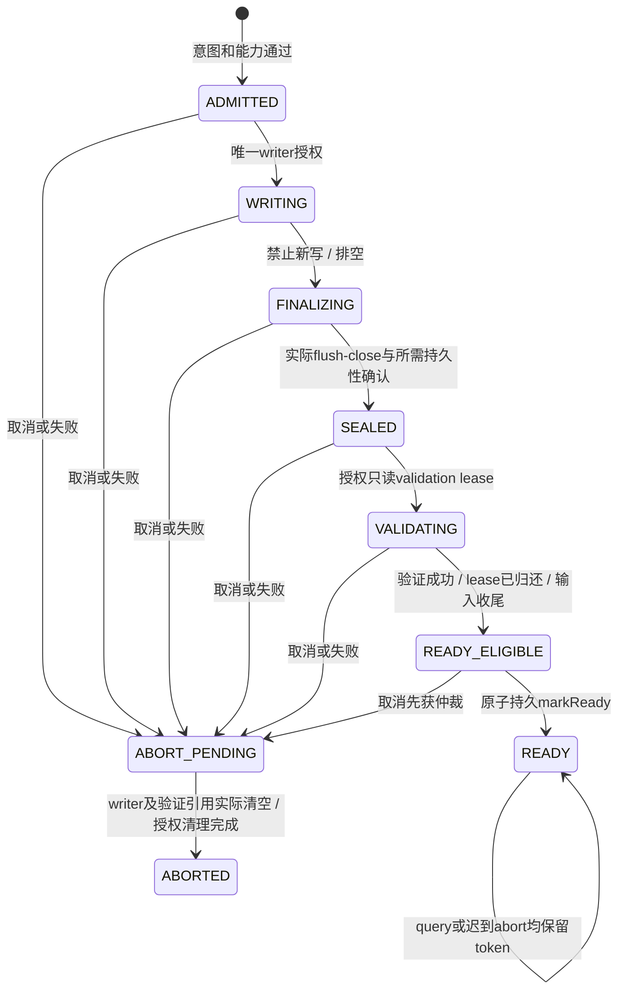

# D1 R2 输出能力、验证租约与恢复方案 V1.0

2026-10-16。回应R1-R02；依据[负责人决定§4](D:/CodexProjects/VideoKit/docs/D1_R1_COORDINATOR_DECISIONS_V1.0.md)、[原文§17.2/17.3](D:/CodexProjects/VideoKit/docs/VideoKit_User_Requirements_and_LocalVideoBrowser_Interface_V1.0_2026-10-05.md:673)、[公共API§7](D:/CodexProjects/VideoKit/docs/PUBLIC_API_CONTRACT_V1.0.md)、[输出设计§2/5](D:/CodexProjects/VideoKit/docs/EDIT_TIMELINE_AND_EXPORT_DESIGN_V1.0.md)。稳定exportId、能力显式、实际停止/关闭/验证归还才READY、业务COMMIT归宿主均已由负责人决定；以下字段/状态/码为待独立评审的细化，不宣称通用Sink已实现。

当前[FencedTask](D:/CodexProjects/VideoKit/docs/coder/d1c14/src/com/videokit/spike/c14/FencedTask.java)只在具体本地目标上持久epoch/owner/worker lease；[SinkCoordinator](D:/CodexProjects/VideoKit/docs/coder/d1c14/src/com/videokit/spike/c14/SinkCoordinator.java)有内部query/READY_UNKNOWN；[PipelineOutputSink](D:/CodexProjects/VideoKit/docs/coder/d1c14/android/com/videokit/spike/c14/PipelineOutputSink.java)仍是本地文件外包顺序channel。它们不是本文件公共通用协议的既成证据。

## 1. 能力表与写前条件

能力由授权目标adapter返回；导出计划声明requiredCapabilities与验证范围。协商先于创建writer/发写FD；可先建立不含媒体字节的持久任务记录。拒绝不能创建第二个目标或暗用本地暂存。

宿主须在writer创建前确认临时目标不与任一输入物理实例重合，包括硬链接/别名；不能仅靠字符串路径不同或扩展名判断。无法证明独占新目标即拒绝，不能先截断再验证。路径/FD具体类型只在平台adapter，核心计划不因此引入Android、NAS或Browser类型。

| 能力字段候选 | 精确定义 | 不满足/未知时 |
|---|---|---|
| sequentialWrite | 从当前位置追加、每次完成量和短写规则；write=0不能无限循环 | required不满足则OUTPUT_CAPABILITY_UNSUPPORTED，stage=OUTPUT_PREFLIGHT，无writer |
| randomWrite / seek | 按64位offset写与定位是分别声明的能力；不从“有FD”推断支持 | 容器要回写而仅顺序则写前拒绝；不能把fMP4具体实现成功外推全部MP4 Sink |
| maxOffset / maxOutputBytes | 最大可表示偏移/允许输出量，不等剩余空间；加法/乘法与实际写前校验 | 不可表示或超授权上限写前拒绝/停止，已写部分走abort，不READY |
| lengthQuery / truncate | 可查询当前长度、可否截断分开；knownLength描述当前临时目标，未知不伪造0 | 计划确实需要而无能力则拒绝。R2首轮不依赖任意目标truncate来隐藏失败 |
| flush / close | flush承诺把调用方缓冲提交到adapter声明层；close承诺该owner句柄和其在途写真实归还 | stream.close不等于dup都关闭，也不自动等于持久；超时/异常保留各自账本 |
| durability | NONE、OS_SYNC_ACK、HOST_DURABLE_ACK三种候选层级，附明确适用存储/事务范围 | 不把fsync叫绝对掉电安全。所需级别无法证明则拒绝或UNKNOWN，不降级成成功 |
| knownFreeSpace | 有值是当时观察，不是空间预留；null为未知 | 若计划要求预留而无reserve能力则拒绝；允许流式模式则按授权字节限额处理实际空间错误，不能“未知=无限” |
| validationReadLease | writer关闭后能否取得绑定同一输出版本的只读验证lease，以及maxRead/length/offset能力 | 本轮要求真实独立读取验证；NONE或能力不足在写前拒绝。不可用“写成功”替代验证，也不暗建可读副本 |
| fdMode / reopenPolicy | 明确BORROW/DUP/TRANSFER；是否允许验证另开只读对象，不允许任意路径复开 | adapter明确一种；首轮跨进程仅评估DUP，其他模式定义不等已准入 |
| authorityDurableQuery | 能否按exportId取回实际任务/owner/handle/终态与同token | 恢复需要它而无实现时不接受该恢复能力；查询失联返回UNKNOWN，不创建新任务规避 |

纯顺序Sink也必须具备计划所需验证lease和flush/close语义；如果目标无法提供，结论是该组合不支持，而非删验证。输出容器/预设选择和输入能力分开，视频专用六帧验证不能替代正式H264/AAC双轨或遮罩覆盖验证。

首轮probe也须明确requiredDurability：若只证明真实文件sync ACK和另一进程重新打开journal，结论范围为该本机进程恢复，不是掉电/系统崩溃安全；NONE不能冒称持久READY。数据sync、journal提交及命名空间/事务ACK各记其实际层级；DirectorySync的noop/mock、单纯close或内存布尔状态不能充当缺失ACK。adapter无法满足声明层级就拒绝/保持未知，不用更名层级制造PASS。

## 2. FD、stream与owner的所有权

| 模式/对象 | 关闭权与持有记录 | 不能作出的推断 |
|---|---|---|
| BORROW | 仅同步调用期间借用；借用方不得关闭/保留。借用调用本身计在途，所有者最终关闭 | 不跨异步/跨进程借用裸fd数字，不把同一整数当跨进程句柄身份 |
| DUP（首轮候选） | 发送者原FD与接收者新FD分别有owner/descriptorId；接收者只关闭其dup，发送者另行关闭原FD。每个wrapper唯一拥有相应FD，禁止双重close伪计数 | close一个dup、关闭stream、解绑或ACK均不证明其他写引用消失；所有writer引用/调用归零才writerClosed |
| TRANSFER | 交接协议必须明确发送者何时放弃所有权、接收者何时接管；丢ACK时两方保持UNKNOWN账本并query | 不把“已发送”当“发送者已实际close”；首轮未选择此模式，不冒称实测 |
| host同步/guard FD | 用于fsync或目标授权的独立引用，即便不写也按用途计账，完成后由宿主close | receiver死亡不自动关闭宿主guard/sync FD |
| 验证read-only FD/Provider | 独立只读打开，绑定validationLeaseId/outputRevision，不借用尚可写对象作为读取快照；validator只关闭自己的引用 | read-only不能撤销其他writer；同UID外部写者/被攻陷持FD者不因只读lease就失去权限 |

writer实际停止证明为：提交停止后无新增写授权、所有已接纳write/flush/close完成、每份写FD/stream已实际关闭，或其唯一持有进程实例已实际死亡且宿主等其他引用另行清空。普通close ACK是受控adapter协议证据，不是抵抗被攻陷worker欺骗的内核撤权证明；任意未证写引用保留PENDING。flock可作合作式排他证据，不当作恶意FD撤销。

## 3. 稳定任务身份、幂等与尝试

| 标识 | 绑定与重放规则 |
|---|---|
| sinkAuthorityId / principal | 宿主输出管理域及授权主体；先认证再query，不因猜中exportId可获目标或token |
| exportId | 一次明确导出意图的稳定幂等键，持久绑定planVersion、sourceLeaseId/sourceVersion集合、preset/验证范围及intentDigest；同ID不同意图拒绝且不产生新writer |
| handleId | 一次授权临时目标，首次成功openTemporary时持久记录；路径只在宿主adapter内部。重复同请求返回同逻辑handle/状态，不另建目标或第二writer |
| ownerEpoch | 宿主原子获取恢复所有权的围栏代次；新epoch拒绝旧owner的新ready/write授权，不能靠增加epoch假装旧FD已close |
| attemptGeneration | 一次实际writer授权代次，区别于C14最多4次codec配置尝试。首轮有限实验每export只授权一个writer attempt=1；重复open不是attempt=2 |
| commandId / writerLeaseId | 每命令幂等键及一次writer授权身份；open回复未知后先query同键，不用新commandId领取第二writer |
| outputRevision / validationLeaseId | writer关闭后封存的输出字节/长度/摘要版本及一次独立验证读取租约；receipt精确绑定该revision，而非任意同名文件 |

首轮恢复非终态只做围栏、清理/abort或查询既有READY，不重启writer/续编码；`attemptGeneration`字段保留以供将来明确协商的重启策略，不借此默许无限重试。用户明确重试导出时，须旧export已ABORTED且资源已证归还，再分配新的导出意图；旧结果UNKNOWN时不得换ID绕过。此为有限实验提案，不削减正式工程可恢复P0；M0评审后可扩明确的重启协议。

输入版本绑定是产物来源证据：receipt须证明读取期间使用所绑定sourceVersions，源在读结束前变动则失败。源资源释放后宿主移动/换版，不自动把已生成旧版本输出改称新来源；业务COMMIT必须再次核当前版本与权限，不能靠旧OutputToken覆盖现源。导出READY不要求所有其他播放消费者也已释放，聚合源是否可移动由源契约另判。

## 4. writer、验证lease与终态

所有状态/身份比较与持久终态仲裁在宿主同一export事务中；外部IO不持状态锁。journal写成功但durability ACK未知时输出UNKNOWN，而不是回滚成“未发生”。observer查询带lastStateSequence；单调只在同任务身份内解释。

同export查询可有新的queryRequestId以观察最新状态，不能换exportId/handleId；相同queryRequestId重放可返回原快照，迟到较小seq不得覆盖新终态。markReady/abort/open的commandId则用于同一副作用幂等，不因查询重试而再执行。query不能独立授予writer或业务COMMIT权。

验证lease只在writer已封存且无未证写引用后创建，能力和验证范围在写前已约定；发出前登记open/read/close在途，取消/恢复先撤销新验证读取再排空已接纳操作。验证完成须回收validator相关资源/只读lease并确认outputRevision仍一致，才能生成receipt。receipt至少含exportId/handleId/ownerEpoch/attemptGeneration/planVersion/sourceVersions/outputRevision/验证方法与轨道范围/结果，不能单用布尔true。validator读超时/close未知为VALIDATION_PENDING，禁止READY和提前删目标。

source依赖任务/相关输入引用在READY_ELIGIBLE前已收尾，SourceReleased终态通知可随后发送，不因通知投递失败重开源。READY是Kit写完与所约定验证通过的结论；宿主后续存在/权限/版本/业务验证、用户确认、改名/索引/提交才是COMMIT。Kit没有COMMIT或源删除接口。

## 5. 恢复和并发对照（未运行）

| ID / 初态与顺序 | 唯一合法结果 |
|---|---|
| O01 READY已持久，回复丢失→同export query/retry | 返回同handle/同token/同intent；不再open，不新writer，不计第二成功输出 |
| O02 WRITING/e1，旧ready与takeover/e2并发 | 若ready先持久：任务READY，takeover仅读既有终态、不更epoch，abort返回READY同token。若takeover先获权：e1 ready拒绝；e2首轮仅围栏/abort，旧writer未证关闭时ABORT_PENDING，归还后ABORTED。不得双终态 |
| O03 stream.close成功，但dup或write在途仍1 | SEALED条件不成立，不开验证lease、不READY；对应引用实际清空后才能继续 |
| O04 声明不能验证读取/容器需要seek但仅顺序 | preflight OUTPUT_CAPABILITY_UNSUPPORTED，writer/写FD/媒体字节均0；任务可保存拒绝元数据，不暗建暂存 |
| O05 validation lease读完但close失败/回调在途 | 保留VALIDATION_PENDING及lease引用；markReady拒绝，取消走ABORT_PENDING，实际关闭后才允许合法终态 |
| O06 两个openTemporary同export/command同时到达 | 意图一致且授权同代时附着唯一open记录；最多一个writer授权。回复未知返回PENDING/query，不能给第二FD作为第二writer |
| O07 同export换planVersion/sourceVersions或preset | EXPORT_FAILED/OUTPUT_IDENTITY/INTENT_CONFLICT，旧任务原样；不同意图必须由宿主明确新任务，不能当幂等重放 |
| O08 cancel请求已发但回复未知，与ready在途交错 | query同export得READY或ABORT_PENDING/ABORTED；UNKNOWN不能显示已取消，也不能另开输出；READY若胜出仍不触发业务COMMIT |
| O09 宿主owner死亡，旧writer仍活 | 恢复新epoch围栏控制命令，旧写FD仍计未证；不靠锁重获/末尾无服务猜writer已归还。首轮只恢复abort或查询既有READY |
| O10 验证receipt来自旧owner/其他handle/revision | 拒绝，不进入READY；无法重新验证且首轮恢复只abort时结束为ABORTED，不能挪用旧true/旧hash |
| O11 正在读验证时取消/删除目标请求 | 撤销新读、排空实际read/close；验证lease未归还前不删目标/不报ABORTED。所有权未证保留PENDING |
| O12 journal丢失/损坏或query失联 | UNKNOWN/RECOVERY_PENDING；不能据“查不到”认定从未open，禁止换ID或清数据获取新输出许可 |

## 6. 错误与兼容提案

| 条件 | 现有码＋stage/reason候选 | retryable与资源事实 |
|---|---|---|
| 能力不符/验证不可读/所需持久性不可提供 | OUTPUT_CAPABILITY_UNSUPPORTED / OUTPUT_PREFLIGHT /具体能力 | false，writer未创建；修改目标/计划须显式新协商 |
| 实际权限/空间错误 | OUTPUT_PERMISSION_DENIED或OUTPUT_SPACE_INSUFFICIENT / OPEN、WRITE、SYNC | 不冒用其他IO异常；是否重试由同任务状态和新权限/空间证据决定，未清理仍PENDING |
| 意图冲突/旧owner/重复非法writer | EXPORT_FAILED / OUTPUT_IDENTITY / INTENT_CONFLICT、STALE_OWNER、GRANT_ALREADY_ISSUED | false；不改旧任务。重复合法命令返回缓存状态而非失败 |
| IO/flush/close/验证失败 | EXPORT_FAILED /对应明确stage | 保存首因、独立cleanup和实际引用；“可重试”不代表可以重开writer |
| query/ready/abort超时或持久性未知 | EXPORT_FAILED / READY_QUERY、ABORT_QUERY、JOURNAL / OUTCOME_UNKNOWN | 仅允许同身份查询，资源PENDING；控制结果UNKNOWN是状态，不新增精确假错误 |
| abort已胜出后ready | CANCELLED / READY_ARBITRATION | false，无token；若READY先胜，abort返回该READY状态而非伪CANCELLED |

本方案不必新增公共输出错误枚举，但需要扩充结构化stage/reason、query状态与身份字段。原Sink三方法签名并未包含所有信息；后续API版本评审需规定optional字段与UNKNOWN兼容，旧binding不理解新状态时必须保守失败/查询，不能把ordinal当已有成功枚举。R2没有修改现有公共API文件或冻结协议。
