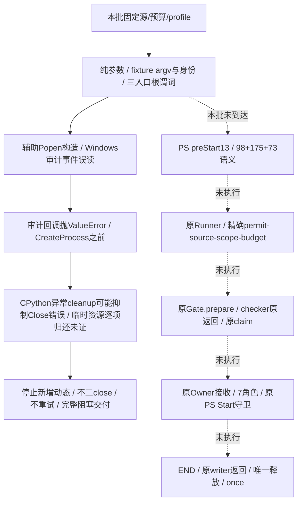

# CONTRACT03_FIX 原调用图与本次实际边界

生产链保持 revision02 的原对象所有权：Process/文件创建登记、Start未进入的精确已知收尾、成功Start后的原pipe/reader/waiter，以及真正未知时的保管；本批不修改这些生命周期函数。只改变完整记录盘点/状态词法、fixture程序守卫、统一根及关联pins。

Runner、Gate、Owner都调用同一 `entry_gates.fixture_root_allowed`；PS固定夹具根同步为本批新根。LIVE仍使用 `d1android02-production-runner01/release/cooperative-default-route.lock`。本批没有进入任何Gate构造/claim/checker/Owner/SDK角色。

原外部事实链及本次静态方案见 EXTERNAL_HANDOFF.md。routeProof只在原Gate.prepare后产生，外部权威来源不能由调用者自写issuer模拟；独立一次性签发与签名验证入口均待负责人审定/实现/独立验证。本批不实现或执行该入口。

错误辅助驱动保留在 selfchecks/run_batch.py、reference/pre-dynamic-profile.json 和完整batch结果中。`selfchecks/profile_guard_v2_static.py`仅为未执行的修正草案：在调用原Popen构造之前验证有限准确argv，Windows审计只记观察，不在已分配临时管道后充当参数拒绝层。没有重跑本批scope。
