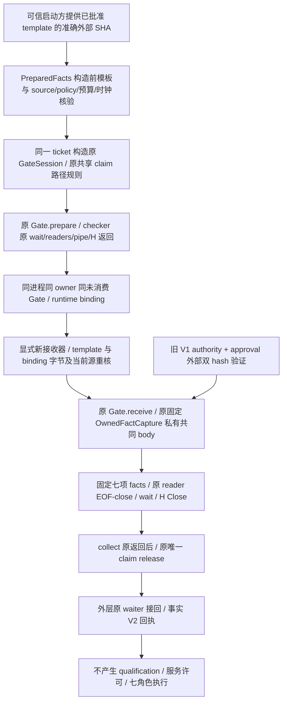

# PREAUTH01 固定调用图

本批仅离线。外部批准输入在fixture中为显式合成数据，不代表负责人真实签发或现场事实。

新facts入口只使用原Gate和collector，不调用Runner.run/Owner/目标七角色。旧Runner源集合从17扩为20，Gate从9扩为12，新增binder/CLI/Schema；不能复用旧seal。旧V1资格解析只更新准确collector源常量，仍仅接受原GLOBAL_IDLE_QUALIFICATION_V1；新capture V2不转换、不填充旧authority/approval字段。V2资格适配本批未实现。

离线驱动复用SELFCHECK02 Capture原wait/readers/stream/H算法、原Journal和原handle身份取得。Popen构造前核全argv/cwd/env/source，Windows audit只记内存观察。显式CLI的两个嵌套子调用另有固定顺序的route_fixture与fact_fixture准确构造前守卫，额外源重读计原Gate账；audit不抛出拒绝。实际工具返回由外层Capture验证，CLI不自证自己已退出。
