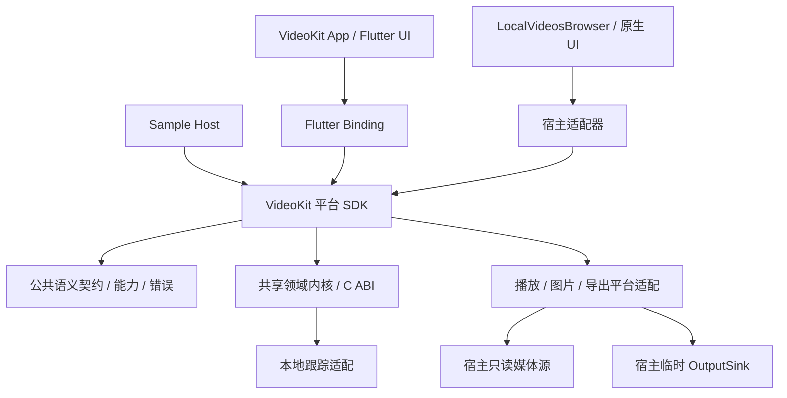

# VideoKit 系统架构

## 2026-10-21 国际化详细设计补充（当前有效）

国际化按[《VideoKit 国际化详细设计》](INTERNATIONALIZATION_DETAILED_DESIGN_V1.0.md)及[国际化数据模型](INTERNATIONALIZATION_DATA_MODEL_V1.0.md)实施。App LocaleController/Repository/ARB资源层管理UI语言，原生Kit输出语言中立code/typedArgs；平台国际化在UI/宿主adapter，不进入媒体Core。四类语言独立：UI、字幕、识别、翻译。UI localeGeneration不改变媒体bindingGeneration/timelineEpoch，不重建播放/编辑/导出。首轮en/zh-Hans；ASR/翻译仍单列扩展。

本次仅文档更新，项目继续暂停；主里程碑、原P0与历史冻结证据保持，D1未过/M0未启。

## 2026-10-21 最新播放子系统设计基线

2026-10-21 用户确认：播放复用 Media3/平台播放器，保留统一 PlaybackBackend 隔离平台实现，libmpv不再列正式选型/对照或计划内验证。识别独立模块优先验证whisper.cpp，翻译独立模块评估llama.cpp+适用模型并可替换，平台适配位于各能力底层。自有开发集中统一API/宿主输入/生命周期/预算/字幕时间轴/取消/Flutter UI与编排，不重造解码/音画同步/推理引擎。

功能层、依赖、线程、原返回、音频tap及字幕/模型边界以[《VideoKit 播放子系统详细设计》](PLAYBACK_SUBSYSTEM_DETAILED_DESIGN_V1.0.md)为当前基线；[数据模型](PLAYBACK_DATA_MODEL_V1.0.md)为同源模型定义。Core不反向依赖ASR/翻译，纯播放包不强制打入模型。后端成熟能力复用，Flutter不维护第二权威状态。原生高风险隔离方案仍需验证。

本节覆盖下文相冲突的历史候选说明；原P0、冻结报告和历史证据保持。仅文档更新，项目继续暂停。

## 最新有效决定：Flutter 自有 Theme，SkinKit 延后（2026-10-20）

先使用 Flutter 开发自有 VideoKit Theme 和完整 App UI，按既有 PPT 样式实现；等 SkinKit 正式支持 Flutter 后再评估并安排集成。当前不做 SkinKit Android 原生桥接，也不以其真实接入作为 M0/M8 的既定退出门。本条覆盖下文此前“暂不自建 Theme”“M0 必须实接 SkinKit”等旧要求；供应方资料与历史要求保留供将来评审，不作为当前强制任务。完整现行范围见 [Flutter Theme 与延后集成决定](FLUTTER_THEME_AND_SKINKIT_DEFERRAL_V1.0.md)。完整 UI 优先、演示数据隔离、后续功能接回以及每批 1–3 个里程碑的集中开发测试规则不变；当前 D1 冻结任务不变，M0 未启动。

## M0 UI 优先实施要求（2026-10-20 最新）

用户最新决定（2026-10-20）：M0 在保留 API/Fake/TestKit/sample-host 原范围的同时，先搭建整个正式 Flutter App 的 UI 框架，按既有 18 页 PPT 的视觉与交互样式实现，并真实集成 SkinKit。允许生成带明确“演示模式·模拟数据”标识的本地测试数据演示全部主要页面与状态；演示不能冒充真实播放、跟踪或导出通过。后续 M1–M6 功能逐批实现并接回同一 UI，M7 保持独立宿主接入，M8 完成全功能真实集成与发布级验收，不再首次重建 UI。继续复用 SkinKit 默认/标准样式与合法最小宿主适配，不另建独立 Theme 系统、主题包或编辑器；通过既有配置与受支持的最小覆盖实现 PPT 样式，无法表达的差异列明评审。

完整范围与退出门槛：[M0 App UI 框架要求](M0_APP_UI_FRAMEWORK_REQUIREMENTS_V1.0.md)。本次为规划更新；D1 尚未通过，M0 尚未启动，不改变已冻结候选或当前设备批次。

## SkinKit 分层约束补充（2026-10-20）

[SkinKit集成](SKINKIT_INTEGRATION_REQUIREMENTS_V1.0.md)是正式App UI强制要求。SkinKit及其Flutter宿主Adapter位于App外观层，不进入videokit-api/core/playback/image/timeline/tracking/export，不将SkinKit类型扩散至公共媒体API或对外原生AAR。可选原生UI如使用主题必须单独薄适配，调用方可移除UI/主题依赖。

App只保有一个Provider/Registry契约与同generation解析快照，桥接不重写四级回退，不引入第二播放状态权威。资源lease/订阅/read view分别有真实生命周期；主题故障默认业务可用。当前Android二进制能力不等于Flutter与其他平台适配完成；相关接口、权限、构建兼容与许可按主要求门禁验证。

## 最新执行决定（2026-10-05）

当前执行调整：Apple/Windows 暂不开发，其最小实现验证不作为 Android M0 前置门禁；当前以接口/依赖兼容性分析代替跨平台实测，相关能力标 NOT_RUN。用户已授权负责人决定实现过程，详见项目决定文件。

[项目决定与执行基线](PROJECT_DECISIONS_AND_EXECUTION_V1.0.md)为最新执行约束，优先于下文旧稿中相冲突的跨平台验证时点或待用户确认表述。

版本：V1.0；日期：2026-10-05；状态：建议方案，待评审及 Spike。

## 1. 推荐方案与取舍

用户已确认 Flutter 构建 VideoKit App 的四平台产品 UI，并在完整 V1.0 展示编辑入口与多画面 UI。全部需求功能按里程碑顺序完成，不拆分不同产品版本。原生 SDK 不依赖 Flutter；Android 使用 Media3 薄适配，Apple 使用 AVFoundation 薄适配，Windows 评估 Media Foundation。共享 C++ 领域内核用于时间线、变换、跟踪结果和导出计划；平台 SDK 负责原生媒体生命周期。稳定 C ABI 作为共享内核的绑定边界，Kotlin/Swift/C++/Dart 公共接口遵守同一语义契约。Flutter 之外的技术选择仍待设计评审。

该建议以闭源发行和源/输出控制为先。平台原生后端不会自动覆盖全部容器；MKV/AVI/复杂字幕等兼容性是必须验证的风险，不以“使用原生”宣称已满足。通过统一接口隔离平台实现，不要求同时实现多个播放后端。libmpv已按2026-10-21决定退出正式候选与对照任务。其他后端不因格式缺口自动获准采用，需单独设计与许可评审。

历史备选：Kotlin Multiplatform + Compose 可降低 Android 当前工程迁移成本，但 App 已选定 Flutter，不再作为待选择路线。Flutter-only + media_kit 可快速做跨平台播放 UI，但原生宿主接入、编辑、输出及生命周期仍需另做，不能成为唯一 Kit。全平台统一 libmpv 可以改善格式一致性，但未解决编辑和 LGPL 分发，不作为默认决定。

## 2. 分层与依赖

App 与 Browser 彼此不依赖；Kit 不导入宿主业务。跨平台共享的目标是行为和数据模型一致，不能用接口统一冒充实现或画质一致。

## 3. 模块规划

保留原文第 24 节所有 Android 模块；增加 shared/domain、shared/schema、bindings/c、bindings/flutter、platforms/apple、platforms/windows、apps/videokit-app。这些是设计目录，不在本轮创建源码模块。

`videokit-api` 不依赖 Media3、Compose、Android Context、AI 与数据库。Android 特定输入/渲染类型放 Android adapter artifact。`videokit-ui` 提供 Compose UI 及 View 容器桥接；纯引擎使用不引入 UI。Flutter UI 复用交互规范，渲染 SDK 的纹理/显示目标，不强制原生宿主嵌入 Flutter。

共享内核不自行持有 Activity、文件路径或凭据；原生 SDK 用串行会话执行器处理命令，不重复在 C++ 和 Kotlin 维护两套同权状态机。C++ 保存可移植编辑计划，平台会话是播放状态的唯一权威来源。

## 4. 媒体数据与渲染路径

控制/低频事件经平台通道，帧经 GPU 纹理/平台显示目标，媒体读取经原生句柄。禁止按帧将视频或 NAS 数据通过 Dart 消息来回复制。Android JNI、Apple Swift/Objective-C、Windows C ABI 分别包装 SDK；同步引擎读取由工作线程适配可取消异步宿主 readAt，避免主线程与回调执行器互等。

编辑预览与导出共享同一不可变计划、PTS 时间映射和遮罩轨迹；GPU shader 分别适配 GLES/Metal/D3D，使用黄金图像测试验证一致性。

## 5. 多实例资源与音频

资源管理器是可注入的宿主范围预算对象，不是全局播放器。按分辨率、编码、帧率、设备声明、历史失败与热状态申请资源；分配先预留后创建，失败有界回退。`getMaxSupportedInstances` 等声明值仅是提示，不能当作可靠实际容量。

会话分别拥有句柄、Surface、解码器和错误状态；共享池使用引用计数。音频由宿主提供单调递增 audioEpoch，切换采用先静音旧槽、再授权新槽；过期命令拒绝。宿主锁定优先于所有后台与音频指令。最多一个可发声会话，释放声音槽后全静音。

## 6. 故障隔离边界

可恢复错误、回调异常、坏媒体与单任务取消必须局限到会话。不能将 try/catch 等同于原生 SIGSEGV 或进程 OOM 隔离。

Android/Windows 对高风险解析、跟踪和导出评估受控 worker 进程，按会话/任务隔离；输入由宿主 broker 授权，使用有界共享缓冲，禁用任意文件和网络访问。进程死亡只释放其任务，不能使用单个全局 worker 导致全槽退出。worker 数量也受预算约束。

iOS 无法按桌面方式任意启动子进程。优先系统媒体服务及限制嵌入式原生依赖；若故障注入证明会导致整个宿主退出，则仍违反原文发布阻断，必须更换组件或提出用户评审，不能声称绝对隔离已经实现。各平台进程边界方案尚待 Spike。

## 7. 交付与演进

Android：API AAR + 可选功能 AAR + TestKit；Apple：XCFramework/Swift wrapper；Windows：DLL/C ABI + 可选 C++ wrapper；Flutter：绑定与控件 package。发布编译产物及来源版本、哈希和 SBOM；同一核心版本配套绑定版本矩阵。

Android 为首个实现与集成验证平台；四平台及全部需求功能属于同一个完整 V1.0 的范围，不将中间里程碑作为功能删减版发布。iOS/Windows/macOS 最小播放、输入和输出验证必须在架构冻结前进行。当前仓库仅有 Android Compose `app` 骨架，无 Git 元数据；本轮不改构建、不迁移现有代码。App Flutter 选择已确认，其余设计仍待评审。

参考：[Flutter 架构](https://docs.flutter.dev/resources/architectural-overview)、[Media3](https://github.com/androidx/media)、[Apple 合成接口](https://developer.apple.com/documentation/avfoundation/avvideocompositing)、[Windows 媒体管线](https://learn.microsoft.com/en-us/windows/win32/medfound/media-sinks)。
