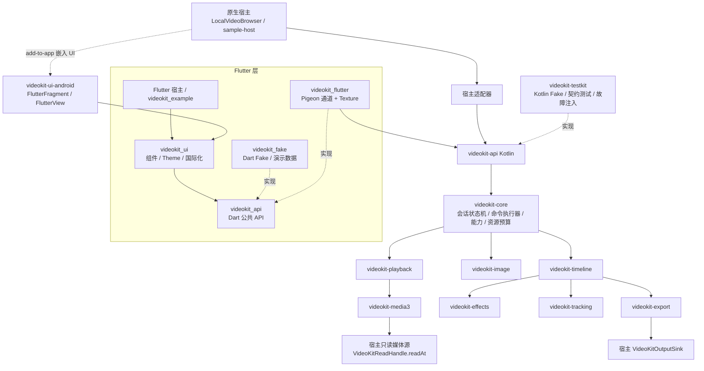

# 02 系统架构

版本：V1.1；日期：2026-11-06；对应原需求 §2、§13、§21、§24、§25、§29、§30。

开发环境：Flutter stable 3.47.7（framework `abaf9c5`，Dart 3.13.5），本机 SDK 路径 `D:\CodexProjects\flutter`；工程初始化时把该版本写入 `.fvmrc` 或 `pubspec.yaml` 的 `environment` 约束与 CI 配置。

> V1.1 变更：为方便全平台开发，**UI 优先使用 Flutter 开发**；原生 Kit（Kotlin + Media3）作为能力层保持不变。

## 1. 总体结构

- 能力层是原生 Kit（Android AAR，原需求的正式交付形态）；UI 层是 Flutter 包。两层通过 `videokit_flutter` 插件连接。
- 原生宿主只依赖原生 `videokit-api`；如果要用 VideoKit 的界面，通过 `videokit-ui-android` 以 add-to-app 方式嵌入 Flutter UI，回调仍走原生 API，宿主不用写 Dart。
- 原生会话是播放与编辑状态的唯一权威；Flutter UI 只订阅状态、发送命令。
- 视频帧经 `TextureRegistry` 提供的 Surface 直接渲染到 Flutter `Texture`，媒体字节和帧不经过 Dart 消息复制。
- 所有文件访问都经宿主提供的输入句柄和输出 Sink，VideoKit 从不直接访问宿主文件系统。

## 2. UI 优先的技术基础

UI 框架先行之所以可行，是因为 `videokit_ui` 只依赖 Dart 版 `videokit_api`：

| 阶段 | UI 连接的实现 |
| --- | --- |
| VK-M0 | `videokit_fake`（Dart Fake：可控时钟、脚本化状态、演示画面），不需要原生实现即可运行 |
| VK-M1 起 | 逐项换成 `videokit_flutter` → 原生 Kit 真实后端（Media3、图片解码、时间线、跟踪、导出） |

同一个 UI 组件在 Fake 和真实实现下行为一致；Dart Fake 与真实插件执行同一套 Dart 契约测试，原生 Fake 与原生实现执行同一套 Kotlin 契约测试（§26.1）。详见 [03 UI 框架设计](03_UI_FRAMEWORK_DESIGN.md) 第 8 节。

## 3. 技术选型

> 媒体相关技术（播放、解码、图片、剪辑、合成、导出、渲染、隔离、跟踪）的逐项决定与待验证项以 [15 媒体技术路线决定](15_MEDIA_TECHNOLOGY_DECISIONS.md) 为准；下表为概览。

| 层 | 决定 | 理由 | 替代方案 |
| --- | --- | --- | --- |
| Kit 语言 | Kotlin，Coroutines/Flow；Java 11 字节码 | 满足 §13.1 挂起调用与 Flow | — |
| UI | **Flutter**（stable 3.47.7，Dart 3.13.5；SDK 位于 `D:\CodexProjects\flutter`），包 `videokit_ui` | 一套 UI 代码覆盖手机/平板及将来的 iOS/macOS/Windows，方便全平台开发 | Jetpack Compose（只覆盖 Android） |
| UI 与原生通信 | Pigeon 生成的类型安全通道；EventChannel 推送状态与事件 | 避免手写字符串协议，类型可检查 | 手写 MethodChannel |
| 视频画面 | `TextureRegistry.SurfaceProducer` → Flutter `Texture` | 帧不经 Dart 复制 | PlatformView（性能差，不用于多画面） |
| 原生宿主嵌入 UI | Flutter add-to-app：预热并缓存 FlutterEngine，`videokit-ui-android` 提供 Fragment/View 包装 | 原生宿主无需写 Dart | 原生宿主只用纯引擎自己画 UI |
| UI 状态管理 | 组件以 `ValueListenable`/`Stream` 订阅 `videokit_api` 状态，不强制宿主使用 Riverpod/Bloc 等框架 | §13.1 不强制依赖注入框架 | — |
| 播放 | AndroidX Media3 ExoPlayer | Apache-2.0，成熟，自定义 DataSource 可接宿主 readAt | 平台 MediaPlayer（能力不足） |
| 编辑/导出 | Media3 Transformer / Composition | 裁剪、拼接、效果、编码一体 | MediaCodec + MediaMuxer 自建（工作量大） |
| 图片 | 平台 `ImageDecoder`（GIF/WebP 动画、HEIF、API 31 起 AVIF）+ `BitmapRegionDecoder` 分块 | 无额外依赖，API 31 覆盖全部格式 | Coil（作为候选，需验证动图暂停/大图） |
| 跟踪 | OpenCV + YuNet（人脸检测）+ ViTTrack（物体跟踪）；推理运行时 OpenCV DNN 与 ONNX Runtime 对照 | 许可适合闭源 | 以 Spike 结果为准，见 [09](09_TRACKING_TECHNICAL_SPIKE.md) |
| 高风险隔离 | 跟踪推理、导出编码、未知格式探测在 `android:isolatedProcess` Service 中运行 | 普通 try/catch 不能隔离 SIGSEGV/OOM | 以故障注入结果为准，见 [07](07_MULTI_INSTANCE_AND_RESOURCE_DESIGN.md) |
| 构建 | Gradle Version Catalog + 依赖锁定 + `verification-metadata.xml` | §23 精确版本与校验 | — |
| FFmpeg | 不引入 | §23 未经批准不得集成 | 若格式缺口需要，单独提交许可评审 |

## 4. 模块

按原需求 §24，原生模块名称沿用，职责不合并；§24 中的 `:videokit-ui`（Android 播放器/编辑器 UI）由 Flutter 包 `videokit_ui` 加原生桥接 `videokit-ui-android` 实现。

### 4.0 原生模块（Kotlin / Android）

| 模块 | 职责 | 允许依赖 |
| --- | --- | --- |
| `videokit-api` | 公共接口、DTO、版本、稳定错误、能力模型 | Kotlin 标准库、Coroutines |
| `videokit-core` | 会话状态机、命令串行执行、能力协商、通用变换、资源预算、事件采样 | api |
| `videokit-playback` | 播放控制、轨道模型、播放事件 | core |
| `videokit-media3` | Media3 薄适配：DataSource、Player、轨道/错误映射 | playback、Media3 |
| `videokit-image` | 静态/动态图片会话、大图分块 | core |
| `videokit-ui-android` | 原生宿主嵌入 Flutter UI 的桥接：引擎预热与缓存、`VideoKitFlutterFragment` / `VideoKitFlutterView`、原生回调转发 | api、Flutter embedding |
| `videokit-timeline` | 片段、排序、关键帧、编辑工程 Schema 与迁移 | api |
| `videokit-effects` | 马赛克、模糊、遮罩渲染 | timeline |
| `videokit-tracking` | 人脸/物体跟踪适配层、覆盖报告 | timeline、OpenCV/ORT |
| `videokit-export` | 编码、拼接、Sink 协调、输出校验 | timeline、effects、Media3 Transformer |
| `videokit-testkit` | Fake 实现、契约测试、故障注入、演示数据 | api |
| `sample-host` | 原生示例宿主 App：纯引擎接入与 add-to-app 嵌入 UI 示例、Kotlin 契约测试宿主 | api、ui-android、testkit、各实现 |

### 4.0.1 Flutter 包（Dart）

| 包 | 职责 | 允许依赖 |
| --- | --- | --- |
| `videokit_api` | Dart 版公共 API，与原生 `videokit-api` 语义一一对应 | 纯 Dart |
| `videokit_ui` | 全部 UI 组件、VideoKit Theme、国际化 | `videokit_api`、Flutter SDK |
| `videokit_flutter` | 插件：Pigeon 通道、Texture、Android 实现（包装原生 AAR） | `videokit_api`、原生 Kit |
| `videokit_fake` | Dart Fake、场景、演示数据、Dart 契约测试 | `videokit_api` |
| `videokit_example` | Flutter 示例 App（含模拟 LocalVideoBrowser 宿主） | 以上全部 |

依赖规则：

- `UI/平台适配器 → core/api ← tracking/export/playback 实现`。
- `videokit-api` 不依赖具体播放器、AI 模型和宿主业务；`videokit_ui` 只依赖 Dart 版 `videokit_api`，修改普通 UI 不会重编译原生编码/AI 模块。
- 跟踪、导出、图片模块可以单独替换或禁用；纯播放组合不包含跟踪和编码依赖。
- 依赖规则用 Gradle 模块依赖检查（如自定义依赖约束任务）在 CI 中强制。

### 4.1 Artifact 组合

| Artifact 组合 | 包含模块 | 适用宿主 |
| --- | --- | --- |
| `videokit-api` | api | 所有宿主（编译期依赖） |
| 播放 | core、playback、media3、image | 只需播放/查看 |
| 播放 UI（原生宿主） | 播放 + ui-android（内含 Flutter UI 产物） | 原生宿主嵌入 VideoKit 界面 |
| Flutter 包 | `videokit_api`、`videokit_ui`、`videokit_flutter` | Flutter 宿主 |
| 编辑 | core、timeline、effects、export | 编辑与导出 |
| 跟踪 | tracking（含模型） | 自动打码 |
| 测试 | testkit | 宿主 CI 与契约测试 |

## 5. 线程与并发

- 每个会话有一个串行命令执行器（`limitedParallelism(1)` 调度器），命令按序执行并返回稳定结果。
- 宿主 `readAt` 是挂起函数，在 IO 调度器执行；Media3 的同步读取线程通过可取消桥接等待结果，绝不阻塞主线程，也不等待 UI 线程。
- 状态用 `StateFlow`；事件用有界 `SharedFlow`，高频进度事件采样合并（具体间隔 M1 冻结）。
- 宿主回调在 VideoKit 管理的协程中调用，带超时；回调异常或超时转为 `HOST_CALLBACK_FAILED`，不中断播放。

## 6. 故障隔离

| 层级 | 机制 |
| --- | --- |
| 可恢复错误、坏媒体、回调异常 | 限定在单个会话，转为稳定错误，其他会话不受影响 |
| 原生崩溃风险高的任务 | 在独立 `isolatedProcess` Service 中运行，按任务或会话隔离，不用一个全局 worker 承担所有槽位 |
| 宿主保护 | VideoKit 加载失败、初始化失败或崩溃时，宿主仍可启动并回退（宿主侧临时播放器） |

隔离效果必须用故障注入在真机验证，不能仅凭设计宣称已隔离（见 [07](07_MULTI_INSTANCE_AND_RESOURCE_DESIGN.md) 第 5 节）。

## 7. 原需求 §29 待定项决定

| # | 待定项 | 决定（评审后冻结） | 替代方案 / 风险 | 冻结时点 |
| --- | --- | --- | --- | --- |
| 1 | Maven group、artifact、namespace、版本 | group `com.videokit`；artifact `videokit-<module>`；namespace `com.videokit.<module>`；SemVer，API 主版本与 artifact 主版本一致 | 对外发行若需正式域名需另核权利 | VK-M0 |
| 2 | 是否拆分播放与编辑 artifact | 拆分，见 4.1 | 合并会让纯播放宿主带上编码/AI 依赖 | VK-M0 |
| 3 | 播放、图像、编码组件与 FFmpeg | Media3 + 平台 ImageDecoder；FFmpeg 不进 V1.0 主线，S2 证明有缺口时作为可选模块另行评审（[15](15_MEDIA_TECHNOLOGY_DECISIONS.md) §3） | MKV/AVI/m2ts 等部分编码可能不支持，由能力报告如实返回 | VK-M1（S2 结论后） |
| 4 | 跟踪技术、模型许可、最低设备 | OpenCV + YuNet/ViTTrack 候选，DNN 与 ORT 对照 | 质量不足时比较第二路线；最低设备由 Spike 测得 | 跟踪 Spike 结束 |
| 5 | 首版输出容器、编码与预设 | MP4 / H.264 / AAC / SDR，预设：原始分辨率、1080p、720p | 部分设备编码器能力不同，由能力报告反馈 | VK-M4 |
| 6 | 无重编码拼接条件 | 容器、编码与 profile、分辨率、帧率、方向、音频参数全部一致，且切点在关键帧；否则转码 | 判断错误会导致花屏，需正反样本验证 | VK-M4 |
| 7 | 跟踪效果、导出速度、内存、温度阈值 | 真机测量后冻结，未测不承诺数值 | — | 各功能里程碑 |
| 8 | Compose、View、纯引擎组合 | 纯引擎（原生 api + 实现）为基础；UI 用 Flutter（`videokit_ui`）；原生宿主经 `videokit-ui-android` 以 add-to-app 嵌入（Fragment/View 形式），不另做 Compose 版 UI | add-to-app 增加包体积与引擎启动耗时，VK-M0 实测；不接受时原生宿主可用纯引擎自画 UI | VK-M0 |
| 9 | OutputSink 写入能力 | 声明式能力：顺序写、随机写、文件描述符模式；导出前按 muxer 需求协商（见 [08](08_EDIT_TIMELINE_AND_EXPORT_DESIGN.md) 第 5 节） | MP4 muxer 通常需要随机写或 FD，纯顺序写需先写私有暂存再顺序复制 | VK-M4 起用，VK-M6 冻结 |
| 10 | 编辑工程 Schema 与恢复 | 版本化 JSON；时间用微秒；坐标归一化；进程终止后编码任务从头重启 | — | VK-M4 |
| 11 | 默认控件布局、主题扩展、宿主叠加层 API | 控件可见性与宿主面板插槽由 API 暴露；主题通过 Flutter `VideoKitTheme`（ThemeExtension Token）与 `VideoKitThemeSource` 覆盖（见 [03](03_UI_FRAMEWORK_DESIGN.md) 第 5、6 节） | 视觉取值待 UI 设计 | VK-M0（API）；视觉在 UI 设计后 |
| 12 | 共享资源池与解码器预算 | 宿主范围的 `ResourceBudget`，先预留后创建，失败有界回退（见 [07](07_MULTI_INSTANCE_AND_RESOURCE_DESIGN.md)） | 设备声明值不可靠，需实测校准 | VK-M3 |

## 8. 原需求 §30 必答问题

| 问题 | 回答 | 详见 |
| --- | --- | --- |
| 如何让宿主提供 SMB 随机读取而 VideoKit 不知道账号和路径 | 宿主实现 `VideoKitReadHandle.readAt`，VideoKit 只拿到不透明 mediaToken 和句柄工厂；Media3 通过自定义 `DataSource` 调用 readAt | [04](04_PUBLIC_API_CONTRACT.md) §5、[06](06_PLAYBACK_AND_IMAGE_DESIGN.md) §3 |
| 如何保证播放资源释放后标签工作队列才移动/复制媒体 | 会话关闭所有输入句柄后才发 `SourceReleased`；宿主在收到该事件后才执行排队的物理操作 | [05](05_LOCALVIDEOBROWSER_INTEGRATION.md) §4 |
| 如何让普通播放和不同 VideoBox 的偏好互不覆盖 | VideoKit 只接收和返回状态快照，不保存 scope；宿主以 `contentId + scope` 持久化 | [05](05_LOCALVIDEOBROWSER_INTEGRATION.md) §3 |
| 如何由宿主统一控制多会话音频、数量和降级 | 宿主持有 `ResourceBudget` 与音频协调；VideoKit 报告能力与降级建议，执行宿主的 `SET_ACTIVE_AUDIO`、`SET_VISIBILITY` 命令 | [07](07_MULTI_INSTANCE_AND_RESOURCE_DESIGN.md) |
| 如何把标签/收藏设计为通用 HostAction | HostAction 只有 ID、文案 key、图标、状态和位置；点击回传 ID，业务全在宿主 | [04](04_PUBLIC_API_CONTRACT.md) §7、[05](05_LOCALVIDEOBROWSER_INTEGRATION.md) §5 |
| 如何确保编辑输出只写临时 Sink 且永不覆盖源 | 输入句柄只读；导出只通过 `VideoKitOutputSink`；API 没有写源或删源的入口；失败时 abort | [08](08_EDIT_TIMELINE_AND_EXPORT_DESIGN.md) §5 |
| 如何让自动跟踪失败区间可见并可人工修正 | 跟踪结果带每段置信状态（TRACKED / LOW_CONFIDENCE / AMBIGUOUS / LOST），时间线标色；用户在任意帧加纠正关键帧，后续轨迹失效重算；导出前强制覆盖检查 | [09](09_TRACKING_TECHNICAL_SPIKE.md) §3、[08](08_EDIT_TIMELINE_AND_EXPORT_DESIGN.md) §4 |
| 如何独立发布 AAR、运行契约测试，并在缺失或故障时由宿主安全回退 | 多 artifact 发布到受控 Maven 仓库；testkit 提供同一套契约测试供 Fake 与真实实现运行；宿主通过自有 contract 接口隔离，VideoKit 不可用时切换临时播放器 | [05](05_LOCALVIDEOBROWSER_INTEGRATION.md) §8、[11](11_TEST_AND_ACCEPTANCE_PLAN.md) |

## 9. 全平台扩展预留

UI 采用 Flutter 的目的就是方便全平台开发。V1.0 只实现 Android 原生 Kit，但以下约束保证将来增加 iOS、macOS、Windows 时只需新增该平台的原生 Kit 与插件实现，`videokit_ui` 与 `videokit_api` 复用：

1. **API 语义平台无关**：状态、命令、错误码、能力、事件使用平台无关的命名与类型（字符串 ID、整型微秒、归一化坐标）；Dart 与 Kotlin 两侧一一对应，将来 Swift/C++ 侧同样遵守。
2. **画面经纹理输出**：各平台插件都通过 Flutter 纹理机制提供画面，UI 不关心平台实现。
3. **UI 只依赖 Dart API**：`videokit_ui` 不含任何 Android 专属代码；平台差异（如方向锁定、全屏）通过 API 命令由平台实现执行。
4. **控制与数据分离**：控制命令与低频事件走通道；帧与媒体字节不经过跨语言消息复制。
5. **工程 Schema 可移植**：编辑工程为版本化 JSON，不含平台类型。

各平台原生 Kit 的媒体后端（如 Apple AVFoundation、Windows Media Foundation）在对应版本另行设计与许可评审；V1.0 不实现、不承诺时间。
