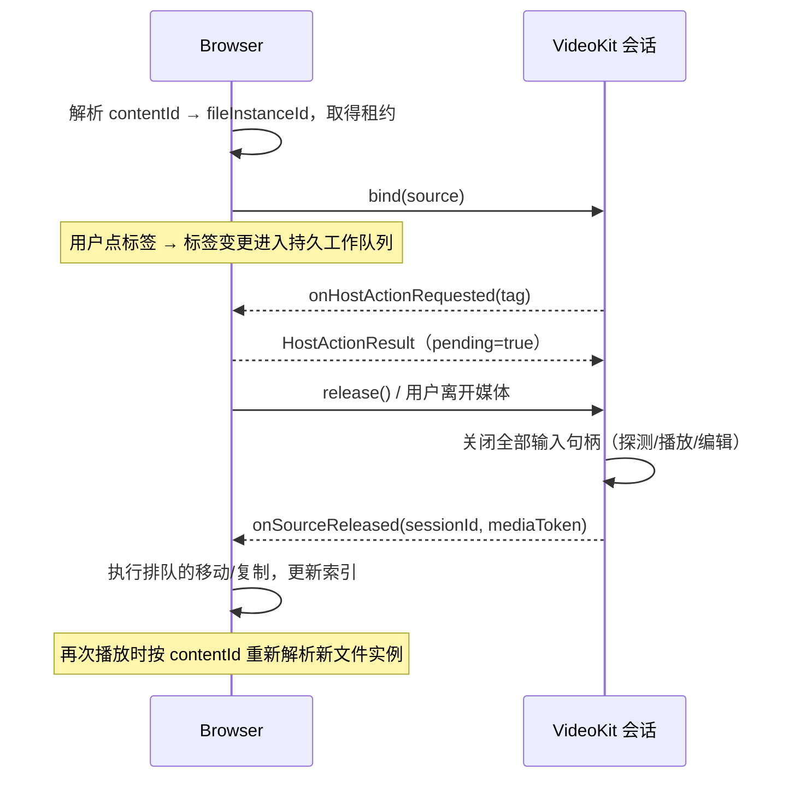

# 05 LocalVideoBrowser 集成

版本：V1.1；日期：2026-11-06；对应原需求 §9、§12、§14.4、§15–§18、§26.7。本文件规定 VideoKit 必须提供的配合能力；LocalVideoBrowser（下称 Browser）的业务实现由 Browser 项目负责。

## 1. 适配层结构

```text
Browser 业务 feature
  └─ 依赖 :contract:playback / :contract:editor（Browser 自有接口）
       └─ 实现：:adapter:videokit（依赖 videokit-api + 所选 artifact）
       └─ 回退：Browser 临时 Media3 播放器 + 图片查看实现
```

- Browser 业务只依赖自己的 contract，不直接依赖 VideoKit 实现。
- 移除 VideoKit AAR 后 Browser 仍能构建运行，使用临时播放器基础浏览（§15.1）。
- Browser 日常 CI 用 `videokit-testkit` 的 Fake 或已发布 AAR，不编译 VideoKit 源码（§25）。

### 1.1 使用 VideoKit 界面的两种方式

VideoKit UI 用 Flutter 实现。Browser 若是原生 Android App：

| 方式 | 依赖 | 说明 |
| --- | --- | --- |
| A：嵌入 VideoKit UI | `videokit-ui-android`（内含 Flutter UI 产物） | 通过 add-to-app 嵌入 `VideoKitFlutterFragment`/`VideoKitFlutterView`；所有回调（HostAction、导航、控件可见性、SourceReleased）仍经原生 `VideoKitHostCallbacks` 交给 Browser，Browser 不需要写 Dart；预热引擎以降低打开播放页耗时 |
| B：纯引擎 | 原生 `videokit-api` + 能力 artifact | Browser 自己画控件，渲染到自己的 Surface |

Browser 若本身是 Flutter App，直接使用 `videokit_ui` + `videokit_flutter`。

方式 A 的包体积与首帧耗时在 VK-M0 实测并写入能力说明，Browser 据此选择。移除 VideoKit 后的回退（§15.1）不受影响：回退的临时播放器是 Browser 自己的原生实现。

## 2. 类型映射

| Browser | VideoKit | 规则 |
| --- | --- | --- |
| BrowserMediaSource | `VideoKitMediaSource` | contentId 由宿主映射为不透明 mediaToken；readAt 由宿主用 SMB/本地实现；不传凭据或完整路径 |
| MediaPlayHobby | `VideoKitPlaybackState` | 字段往返不丢失（见第 3 节） |
| Browser 宿主动作 | `VideoKitHostAction` | 标签、收藏、移除当前项等只用 actionId |
| VideoKitOutputToken | Browser FileOperationPlan | 由 Browser 验证与提交 |
| VideoKitStableError | Browser 稳定错误 | 按 code 映射，未知码按内部错误处理 |

## 3. 播放偏好与作用域（§15.3）

`VideoKitPlaybackState` 字段覆盖 MediaPlayHobby：zoom、panX、panY、rotation、fitMode、preferredOrientation、fullscreen、positionUs?、speed?、volume?、muted?、subtitleTrackId?、audioTrackId?、lastViewedAt。

- VideoKit 不保存 scope；只在 `bind` 时接收初始快照，在变化稳定后与 `release` 时返回最新快照。
- Browser 以 `contentId + scope`（SINGLE / VIDEO_BOX(videoBoxFileId)）持久化，因此普通播放与不同 VideoBoxFile 互不覆盖。
- 图片快照中视频专属字段为空。
- 宿主保存失败不阻止会话释放。

## 4. 媒体租约与 SourceReleased（§9.2、§14.4）



- VideoKit 只有在该会话为此媒体打开的所有句柄都已关闭后，才发出 `SourceReleased`。
- 租约有效期间 VideoKit 继续使用当前句柄，不自行刷新路径；释放后不用旧路径重连。

## 5. 宿主动作（§9）

- 标签：点击 → 回传 actionId；标签选择、创建与校验在 Browser；VideoKit 只显示宿主回传的 pending/selected。
- 收藏：Browser 读写收藏并回传新的 selected 状态。
- 移除当前项（手动 VideoBox）：VideoKit 只发动作 ID，不修改集合；动态 VideoBox 由 Browser 不提供该动作（§16.3）。
- 故障：超时或失败不影响播放；显示轻量错误或恢复按钮，文案可由宿主提供；重复点击合并。

## 6. 邻近媒体列表与导航（§15.2）

- 邻近媒体查询、分页、预览图、滚动状态都属于 Browser。
- Browser 二选一：在 VideoKit 渲染区域外叠加原生列表（随 `controlsVisible` 同步显隐），或在 Flutter 宿主中通过宿主面板插槽放入（[03](03_UI_FRAMEWORK_DESIGN.md) 第 6 节）。
- 列表随 `controlsVisible` 同步显隐。
- 点击邻近媒体：Browser 解析新 contentId、获取新租约，再 `bind` 到现有会话或新建会话。
- 图片左右翻页：VideoKit 发 `NavigationRequest(direction)`，Browser 决定前后媒体并重新绑定，不拼路径。

## 7. 多画面（§16）

Browser 的 PlaybackCoordinator 负责：按 VideoBoxFile 成员创建/销毁会话；手机 4、平板 9、最多 12 的布局；顺序、拖动重排与当前批次；每个 VideoBoxItem 的偏好；唯一声音来源；按可见性暂停、恢复或释放；按能力报告降级并向用户解释。VideoKit 只负责每个会话，见 [07](07_MULTI_INSTANCE_AND_RESOURCE_DESIGN.md)。

## 8. 编辑输入与输出提交（§12、§17）

- 输入：一个或多个只读媒体源、不透明 token、显示名与技术提示、当前播放位置、宿主允许的编辑能力与导出预设、临时输出 Sink。不传 SMB 凭据、标签仓储或文件事务引擎。
- 输出：VideoKit 写入宿主 Sink，`markReady` 后返回 `VideoKitExportResult`（含 outputToken、editProjectId、sourceTokens）。
- 提交：Browser 执行“计划 → 权限/空间/版本验证 → 验证输出 → 用户确认 → 暂存/最终改名 → 更新索引和资料 → 清理临时文件”。VideoKit 不参与、不能绕过，也没有永久删除接口。
- 编辑后业务（新视频继承正式名称、原视频改名 `视频名_dump_日期` 或永久删除、“已编辑视频”配对页）全部在 Browser；VideoKit 只提供 editProjectId、输入 token 列表与输出 token 供配对。

## 9. 回退与故障

- Browser 在 VideoKit 初始化失败、加载失败或会话致命错误时切换到临时播放器，并继续启动与浏览（§26.7）。
- VideoKit 崩溃风险高的任务运行在隔离进程（[07](07_MULTI_INSTANCE_AND_RESOURCE_DESIGN.md) 第 5 节），降低拖垮 Browser 进程的可能。

## 10. 集成契约测试（§26.7）

`videokit-testkit` 提供 `BrowserIntegrationContract`，Browser 适配器在其 CI 中运行：

| 用例 | 检查 |
| --- | --- |
| 源映射 | BrowserMediaSource → VideoKitMediaSource，不暴露凭据和路径 |
| 偏好往返 | MediaPlayHobby 全字段往返；SINGLE/VIDEO_BOX 隔离由宿主完成 |
| 动作 | 标签/收藏只回传 ID；超时失败不影响播放 |
| 租约 | 标签操作等待 `SourceReleased` 后执行 |
| 控件同步 | `controlsVisible` 驱动邻近媒体条 |
| 多会话 | 音频唯一与资源限制由 Browser 协调 |
| 输出 | 只进入宿主 Sink |
| 回退 | 移除 AAR 后临时播放器可构建运行；VideoKit 失败不阻止启动 |

原生 `sample-host` 与 Flutter `videokit_example` 都内置一个模拟 Browser 的宿主（假 NAS 源、标签/收藏动作、邻近列表、VideoBox 多画面、临时 Sink），分别演示方式 A/B 与 Flutter 宿主接入，作为契约的可运行示例。
